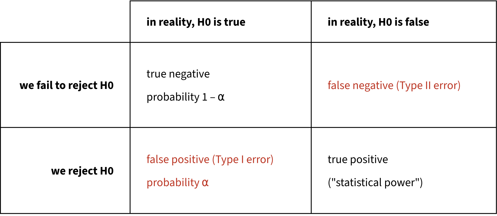

```{r}
#| label: setup
#| include: false

library(tidyverse)
library(patchwork)

options(digits=7)

dapr1blue <- '#0F4C81'

# # i have no idea why these options aren't "taking"
# # for the plots in this file specifically
# theme_set(theme_minimal())
# theme_update(
#   text = element_text(family = 'Source Sans 3', size = 100),
#   panel.grid.minor = element_blank(),
#   strip.background = element_blank(),
#   strip.text.x = element_text(size = 24)
# )
```

```{r include=F}
set.seed(1)
iq_data <- tibble(
  iq = rnorm(n = 99, mean = 100, sd = 20) |> round()
) |>
  bind_rows(
    tibble(iq = 155)
  )
obs_sample_mean <- mean(iq_data$iq)
```

# Hi, I'm Elizabeth! :)

## This week's learning objectives

What is the basic logic behind Null Hypothesis Significance Testing (NHST)?

- We imagine we're in a world where the effect we're interested in does not exist.
- We use our observed data to figure out how likely it is that we're actually in that world.
- If we decide that we're sufficiently unlikely to be in that world, we reject the null hypothesis.

What are the five steps of doing NHST?

- Based on your RQ, define the null and alternative hypotheses
- Collect sample data and determine the appropriate comparison distribution (aka the null distribution)
- Calculate the test statistic for our observed sample
- Make a decision about whether or not to reject H0
- Interpret this decision in the context of the RQ

What kinds of errors is it possible to make when doing NHST?

- Your decision is either to reject the null or fail to reject the null, and you can either do this correctly or incorrectly.
- If you incorrectly reject the null (i.e., you reject H0 when you actually shouldn't), this is a false positive, and we call it a Type I error. 
  - When alpha = .05, you can expect to make a Type I error about 5% of the time.
- If you incorrectly fail to reject the null (i.e., you fail to reject H0 when you actually should), this is a false negative, and we call it a Type II error. 
  - Bonus: Type II error rate ties into a concept called "statistical power", which is the probability of correctly rejecting H0. More on power in your future statistical training!
  

# Every test starts with a research question (RQ)

## Our RQ: Do bilingual people have higher IQ <br> than the general population?

<br>

Standard IQ tests assume that in the general population,

- IQ scores are normally distributed,
- the mean IQ score is 100, and
- the standard deviation (SD) of IQ scores is 15.

So, the distribution of IQ scores in the population looks like this:

<br>
<br>

```{r echo=F, fig.width=8, fig.height=3, fig.align = 'center'}
#| out.width: 1100px

mu <- 100
sigma <- 15

x <- seq((mu - 4*sigma), (mu + 4*sigma), length.out = 1000)
y <- dnorm(x, mean = mu, sd = sigma)
df <- data.frame(x = x, y = y)

p_iq_pop <- ggplot(df, aes(x = x, y = y)) +
  geom_line(linewidth = 1, color = "#0F4C81") +
  labs(x = "IQ scores in the population", y = "Density") +
  scale_x_continuous(breaks = seq(
    (mu - 4*sigma), (mu + 4*sigma), by = sigma)
    ) +
  theme_classic() +
  theme(
    text = element_text(family = 'Source Sans 3', size = 24),
    axis.title = ggplot2::element_text(color = dapr1blue)
  ) +
  NULL

p_iq_pop
```


## Imagine you observe something like this

<br>

You get data from one bilingual person, and their IQ is 105.

<br>

```{r echo=F, fig.width=8, fig.height=3, fig.align = 'center'}
#| out.width: 1100px
curr_iq <- 105
p_iq_pop +
  geom_vline(xintercept = curr_iq, colour = 'tomato1', linewidth = 2) +
  NULL
```

:::{.dapr1callout}
Imagine you're drawing samples from the population distribution.

Vote by show of thumbs: How likely do you think it would be to sample IQ = 105 from this distribution?

 <b>= very likely</b>

 = <b>very unlikely</b>
:::


## Imagine you observe something like this {visibility="uncounted"}

<br>

Now you get data from another bilingual person, and their IQ is 120.

<br>

```{r echo=F, fig.width=8, fig.height=3, fig.align = 'center'}
#| out.width: 1100px
curr_iq <- 120
p_iq_pop +
  geom_vline(xintercept = curr_iq, colour = 'tomato1', linewidth = 2) +
  NULL
```

:::{.dapr1callout}
Vote by show of thumbs: How likely do you think it would be to sample IQ = 120 from this distribution?

 <b>= very likely</b>

 = <b>very unlikely</b>
:::


## Imagine you observe something like this {visibility="uncounted"}

<br>

Now you get data from a third bilingual person, and their IQ is 155.

<br>

```{r echo=F, fig.width=8, fig.height=3, fig.align = 'center'}
#| out.width: 1100px
curr_iq <- 155
p_iq_pop +
  geom_vline(xintercept = curr_iq, colour = 'tomato1', linewidth = 2) +
  NULL
```

:::{.dapr1callout}
Vote by show of thumbs: How likely do you think it would be to sample IQ = 155 from this distribution?

 <b>= very likely</b>

 = <b>very unlikely</b>
:::


## This is a super important intuition!!

<br>

::::{.columns}
:::{.column width="50%"}
If our observations from bilingual people are **likely** to come from the population distribution, then we might hypothesise that **it's likely for bilingual people to have the same IQ as the general population.**
:::
:::{.column width="50%"}
```{r echo=F, fig.width=5, fig.height=2, fig.align = 'center'}
p_iq_pop +
  geom_vline(xintercept = 105, colour = 'tomato1', linewidth = 2) +
  NULL
```
:::
::::

::::{.columns}
:::{.column width="50%"}
If our observations from bilingual people are **unlikely** to come from the population distribution, then we might hypothesise that **it's unlikely for bilingual people to the same IQ as the general population.**
:::

:::{.column width="50%"}
```{r echo=F, fig.width=5, fig.height=2, fig.align = 'center'}
p_iq_pop +
  geom_vline(xintercept = 155, colour = 'tomato1', linewidth = 2) +
  NULL
```
:::
::::

**These hypotheses are so important that statisticians have given them specific names.**

- "Bilingual people have the same IQ as the general population" = our **null hypothesis,** written **H0.**
- "Bilingual people don't have the same IQ as the general population" = our **alternative hypothesis,** written **H1.**


## TODO Null and alternative hypotheses

- in words
- in fancy math text
- in plain text
- H1 links to RQ


# Null hypothesis ✅  <br> "significance testing" ⁉️

## FIXME Let's set the scene first

<br>

When we do NHST, our goal is to **find out how likely it is that we are in a world where the null hypothesis is true.**

To do that, we must work out **what samples like ours WOULD look like IF the null hypothesis were true.**

<br>

So first: What does our sample actually look like?

<br>

::::{.columns}
:::{.column width="48%"}

We have IQ scores from 100 bilingual people.

```{r}
iq_data |> 
  head()
```
:::
:::{.column width="4%"}
:::
:::{.column width="48%"}

The mean IQ score of this sample is:

```{r}
options(digits=22)  
# FIXME rendered output rounds to nearest integer despite this option being set
iq_data |>
  summarise(
    m = mean(iq)
  )
```


<!-- ```{r fig.width = 7, fig.height = 4, fig.align = 'center'} -->
<!-- #| code-fold: true -->
<!-- iq_data |> -->
<!--   ggplot(aes(x = iq)) + -->
<!--   geom_density(linewidth = 1, colour = '#0F4C81') + -->
<!--   theme_minimal() + -->
<!--   theme( -->
<!--     text = element_text(family = 'Source Sans 3', size = 24), -->
<!--     axis.title = element_text(color = '#0F4C81') -->
<!--   ) + -->
<!--   labs( -->
<!--     y = 'Density', -->
<!--     x = 'IQ scores from bilingual sample\nwith size n=100' -->
<!--   ) -->
<!-- ``` -->

:::
::::


## What sample means would be likely if the H0 were true?

<br>

<!-- If the H0 is true, bilingual people have the same IQ as the general population. -->

<!-- <br> -->

We want to see what sample means would be likely if bilingual people have the same IQ as the population.

To do this, we can either:

<br>

::::{.columns}
:::{.column width="40%"}

- take the population distribution
- draw a bunch of samples of size 100 from it (the same size as our sample)
- get the mean of each of those samples
- make a distribution of those sample means
:::
:::{.column width="20%" .hcenter}

**OR**
:::
:::{.column width="40%"}

- use the statistical machinery you've seen in previous weeks to precisely calculate the distribution of sample means we would expect to see if H0 were true
:::
::::

<br>

Why do we want to find the distribution of the sample means we would expect if H0 were true?

So that we can **compare our observed sample mean to it and see how different our observation is from what we *would* get if H0 *were* true.**


## The null distribution

<br>

There is a name for **the distribution that sample means *would* have *if* the null hypothesis were true.**
It is called the **"null distribution",** and sometimes also called the "comparison distribution".

<br>

For this kind of analysis, the null distribution has the following properties:

- **mean =** the population mean = the mean in our H0 = $\mu$

- **SD =** the standard error of the mean = the standard deviation of the sampling distribution of means = $\frac{\sigma}{\sqrt{n}}$

<br>

::::{.columns}
:::{.column width="40%"}
The mean of the null distribution is **100.**

We know the population SD $\sigma$ is 15, and we know we have a sample size $n$ of 100. So:

$$
\begin{align}
\text{SD} &= \frac{15}{\sqrt{100}} \\[.5em]
  &= \frac{15}{10} \\[.5em]
  &= 1.5
\end{align}
$$

:::
:::{.column width="60%"}

```{r echo=F, fig.width=7, fig.align='center', fig.height = 4}
options(digits=7)
h0_mean <- 100
h0_sd <- 1.5
nx <- seq(h0_mean-4*h0_sd, h0_mean+4*h0_sd, length.out = 1000)
p_nulldist <- tibble(
  x = nx,
  n_dens = dnorm(nx, mean = h0_mean, sd = h0_sd)
) |>
  ggplot(aes(x = x, y = n_dens)) +
  geom_line(linewidth = 1.5, colour = dapr1blue) +
  # geom_ribbon(
  #   aes(
  #     x = ifelse(x >= -2 & x <= 2, x, NA), 
  #     ymin = 0,  ymax = n_dens), 
  #   alpha = 0.3, fill = dapr1blue
  #   ) +
  # geom_vline(xintercept = h0_mean, linetype = 'dashed', linewidth = 1) +
  # geom_vline(xintercept = h0_mean + h0_sd, linetype = 'dotted', linewidth = 1) +
  # geom_vline(xintercept = h0_mean + 2 * h0_sd, linetype = 'dotted', linewidth = 1) +
  # geom_vline(xintercept = h0_mean - h0_sd, linetype = 'dotted', linewidth = 1) +
  # geom_vline(xintercept = h0_mean - 2 * h0_sd, linetype = 'dotted', linewidth = 1) +
  labs(
    y = 'Density',
    x = 'Our null distribution'
  ) +
  theme_classic() +
  theme(
    panel.grid = element_blank(),
    text = element_text(family = 'Source Sans 3', size = 24),
    axis.title = ggplot2::element_text(color = dapr1blue)
  ) +
  scale_x_continuous(breaks = seq(
    (h0_mean - 4*h0_sd), (h0_mean + 4*h0_sd), by = h0_sd)
    ) +
  NULL
p_nulldist
```

:::
::::


## Why is the null distribution useful?

```{r echo=F, fig.width=7, fig.align='center', fig.height = 4}
p_nulldist
```


<br>

Because it shows us how sample means *would* be distributed *if* the H0 were true.

And we can **compare our observed sample mean to this distribution.**


If our sample is unlikely enough to have come from the null distribution, then we say we are unlikely enough to be in a world where the H0 is true, and we can **reject the H0.**

So what's **"unlikely enough"?**


## What's "unlikely enough"?

<br>

In Psychology, we usually want data like ours to have a less than 5% chance of coming from the null distribution.

This means that **5% of the time, we'll be rejecting the H0 when actually we shouldn't.**
That's the level of risk we're willing to accept.

<br>

This is another idea that's so important that it has a specific name:

A 5% probability of incorrectly rejecting H0 = our **significance level** or **alpha level**, also written $\alpha$ = .05.


<br>

::::{.columns}
:::{.column width="50%"}

For our one-tailed, directional H1:

```{r echo=F, fig.width=7, fig.align='center', fig.height = 4, warning = F}
uppertail_5perc <- (qnorm(0.05, lower.tail=F) * h0_sd) + h0_mean

p_nulldist +
  geom_ribbon(
    aes(
      x = ifelse(x >= uppertail_5perc, x, NA),
      ymin = 0,  ymax = n_dens),
    alpha = 0.3, fill = dapr1blue
    ) +
  annotate("text",x=106, y=0.2, label="5%\nprobability", col=dapr1blue, hjust=1, size = 8)+
  geom_curve(aes(x=104, xend=103, y=0.15, yend=0.01), col=dapr1blue, size=0.5, curvature = -0.1, arrow = arrow(length = unit(0.1, "npc")), linewidth = 1.5)+
  NULL
```


:::
:::{.column width="50%"}

For a two-tailed, non-directional H1:

```{r echo=F, fig.width=7, fig.align='center', fig.height = 4, warning = F}
p_nulldist +
  geom_ribbon(aes(
      x = ifelse(x >= h0_mean+2*h0_sd, x, NA),
      ymin = 0,  ymax = n_dens),
    alpha = 0.3, fill = dapr1blue
    ) +
    geom_ribbon(aes(
      x = ifelse(x <= h0_mean-2*h0_sd, x, NA),
      ymin = 0,  ymax = n_dens),
    alpha = 0.3, fill = dapr1blue
    ) +

  annotate("text",x=106, y=0.12, label="2.5%\nprobability", col=dapr1blue, hjust=1, size = 8)+
  annotate("text",x=94, y=0.12, label="2.5%\nprobability", col=dapr1blue, hjust=0, size = 8)+
  
  geom_curve(aes(x=104, xend=103.3, y=0.07, yend=0.01), col=dapr1blue, size=0.5, curvature = -0.1, arrow = arrow(length = unit(0.1, "npc")), linewidth = 1.5)+
  geom_curve(aes(x=96, xend=96.7, y=0.07, yend=0.01), col=dapr1blue, size=0.5, curvature = 0.1, arrow = arrow(length = unit(0.1, "npc")), linewidth = 1.5)+
  NULL

```

:::
::::


# Let's actually do the test

## Compare our sample mean to the null distribution of sample means

```{r echo=F, fig.width=7, fig.align='center', fig.height = 4, warning = F}
p_nulldist +
  geom_ribbon(
    aes(
      x = ifelse(x >= uppertail_5perc, x, NA),
      ymin = 0,  ymax = n_dens),
    alpha = 0.3, fill = dapr1blue
    ) +
  geom_vline(xintercept = obs_sample_mean, linewidth = 2, colour = 'tomato1') +
  annotate("text", x=obs_sample_mean+0.5, y=0.18, label= paste0("observed\nsample\nmean:\n", obs_sample_mean), col="tomato1", hjust=0, size = 8)+

  NULL
```

<br>

Our sample mean is sufficiently unlikely, assuming the H0 is true!

We can tell because it's in the most extreme 5% (where "extreme" is in the direction of our H1).

But **how unlikely exactly?**

## How unlikely exactly is our sample mean?

To figure this out, we will use `pnorm()` to compute the area under the normal distribution that's more extreme than our observed sample mean.

In order to use `pnorm()`, we'll first convert our observed sample mean into a z-score.

<br>

::::{.columns}
:::{.column width="40%"}

$$
\begin{align}
Z &= \frac{\bar{x} - M}{SD} \\[.5em]
  &= \frac{\bar{x} - \mu}{\sigma / \sqrt{n}}
\end{align}
$$

We know that $\bar{x}$ = `r obs_sample_mean`, $\mu$ = 100, $\sigma$ = 15, and $n$ = 100, so:

$$
\begin{align}
  &= \frac{102.83 - 100}{15 / \sqrt{100}} \\[.5em]
  &= \frac{2.83}{1.5} \\[.5em]
  &= 1.89
\end{align}
$$

:::
:::{.column width="60%"}

```{r}
1 - pnorm(1.89)
```

<br>

```{r echo=F, fig.width=7, fig.height=5, fig.align = 'center', warning = F}
obs_z <- 1.89

mu <- 0
sigma <- 1

x <- seq((mu - 4*sigma), (mu + 4*sigma), length.out = 1000)
y <- dnorm(x, mean = mu, sd = sigma)
df <- data.frame(x = x, y = y)

p_stdnorm <- ggplot(df, aes(x = x, y = y)) +
  geom_line(linewidth = 1, color = "#0F4C81") +
  labs(x = "Z", y = "Density") +
  scale_x_continuous(breaks = seq(
    (mu - 4*sigma), (mu + 4*sigma), by = sigma)
    ) +
  theme_classic() +
  theme(
    text = element_text(family = 'Source Sans 3', size = 28),
    axis.title = element_text(color = dapr1blue)
  ) +
  NULL

p_stdnorm +
  geom_vline(xintercept = obs_z, colour = 'tomato1', linewidth = 1.5) +
  geom_ribbon(
    aes(
      x = ifelse(x >= obs_z, x, NA),
      ymin = 0,
      ymax = y
    ),
    fill = 'tomato1', alpha = 0.3
  ) +

  annotate("text",x=4, y=0.2, label="2.9%\nprob.", col='tomato1', hjust=1, size = 8)+
  
  geom_curve(aes(x=3.5, xend=2.2, y=0.13, yend=0.02), col='tomato1', size=0.5, curvature = -0.1, arrow = arrow(length = unit(0.1, "npc")), linewidth = 1.5)+
  NULL

```


:::
::::

This probability—the probability of observing data like ours or more extreme—is known as our test's **p-value.**


## Interpreting p-values

<br>

Our p-value is .029, which means **there's a 3% chance of observing data like ours or more extreme, assuming the H0 is true.** 
How cool is it that we can figure this out!

<br>

This p-value is below $\alpha$ = .05, so:

- the result is statistically significant, and
- we can reject H0.
- **It does NOT mean that the H1 is proven true or that we can accept the H1!**
- It also doesn't mean that the difference is *practically* significant, necessarily.

<br>

If the p-value were NOT below $\alpha$ = .05, then

- the data would be insufficiently unlikely under the H0, meaning
- the result would not be statistically significant, and
- we would fail to reject H0.
- **This would NOT mean that the H0 is proven true or that we can accept the H0!**


## Reporting this test in APA notation

<br>

**With fancy formatting:**

> Let $\mu$ denote the mean IQ score of bilingual people in the UK.
At the 5% significance level, we performed a one-sample z-test of $H_0 : \mu$ = 100 against $H_1 : \mu$ > 100.
>
> The sample mean IQ score of bilingual people ($M$ = `r obs_sample_mean`, $SD$ = `r sd(iq_data$iq) |> round(2)`) was significantly higher than the national average ($z$ = `r obs_z`, $p$ = .029, one-sided).

<br>
<br>

**In plain text,** like you might write in your R script:

<br>

:::{style="font-size:150%;"}

```
Let mu denote the mean IQ score of bilingual people in the UK. At the 5% significance level, we performed a one-sample z-test of H0: mu = 100 against H1: mu > 100.

The sample mean IQ score of bilingual people (M = 102.83, SD = 18.67) was significantly higher than the national average (z = 1.89, p = 0.29, one-sided).
```

:::

## Summary: The five steps of NHST

<br>

1. Based on your RQ, define the null and alternative hypotheses.
1. Collect sample data and determine the appropriate comparison distribution / null distribution.
1. Calculate the test statistic for our observed sample (in our case, this was the z-score).
1. Make a decision about whether or not to reject H0.
1. Interpret this decision in the context of the RQ.

# Are we making the right decision?

## Are we making the right decision?

<br>

There are two possible states that the real world could be in:

1. **Our null hypothesis is true** (e.g., bilingual people have the same IQ as everyone else).
2. **Our null hypothesis is false** (e.g., bilingual people don't have the same IQ as everyone else).

Ideally, our decision about H0 would match this perfectly.
But remember that there's some risk involved in our statistical testing: 
**5% of the time, we will incorrectly reject H0 when we should actually fail to reject it.**

<br>

{fig-align="center"}


## Type I error and Type II error

<br>

I think these might be the least useful names for any statistical concept.

Here's how I remember which is which: using the story of the **boy who cried wolf.**

<br>

::::{.columns}
:::{.column width="45%"}

**Part 1 of the story:**

- Boy cries "Wolf!" and everyone reacts
- There is no wolf (and everyone is annoyed with the boy)

:::
:::{.column width="10%"}
:::
:::{.column width="45%"}

**Type I error:**

- We reject the H0
- There is no effect, no reason to reject H0

:::
::::

<br>

::::{.columns}
:::{.column width="45%"}

**Part 2 of the story:**

- Boy cries "Wolf!" but now nobody reacts
- But this time there *is* a wolf oh no!

:::
:::{.column width="10%"}
:::
:::{.column width="45%"}

**Type II error:**

- We fail to reject the H0
- There is an effect, a reason to reject H0

:::
::::

## TODO real-world consequences ?


# Back matter {.appendix}

## Learning objectives revisited

TODO

