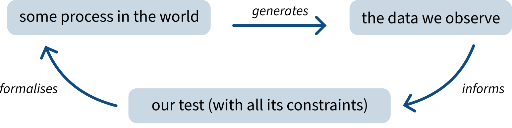
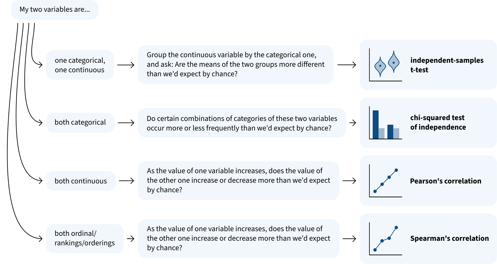

```{r}
#| label: setup
#| include: false

library(tidyverse)
library(patchwork)

dapr1blue <- '#0F4C81'

source('_theme/theme_quarto.R')

theme_update(
  text = element_text(family = 'Source Sans 3'),
  panel.grid.minor = element_blank(),
  strip.background = element_blank(),
  strip.text.x = element_text(size = 24)
)
```

# Welcome back to DAPR!

## Welcome back warm-up

<br>

:::hcenter
:::woo
https://app.wooclap.com/events/UKCQTAU/
:::
:::


## This week's learning objectives

<br>

:::{.dapr1callout .fragment}

What kind of test do we use to compare a variable's mean to a specific value?

<!-- - one-sample t-test -->

:::

:::{.dapr1callout .fragment}
If we want to use this test, what must we assume to be true about the data/the test?

<!-- 1. dependent variable is numeric; -->
<!-- 1. variable is normally distributed OR sample size >= 30; -->
<!-- 1. observations are sampled independently -->
:::

:::{.dapr1callout .fragment}
How do we check whether it's reasonable to make those assumptions?

<!-- 1. check that variable is on interval/ratio/integer scale -->
<!-- 1. visually with plots (hist, dens, qq), statistically with Shapiro-Wilk -->
<!-- 1. check that each data point comes from a separate source (e.g., a separate person) -->
:::


# Recap: One-sample t-test

## One-sample t-test example: College loneliness

With a one-sample t-test, we can test whether a sample's mean is significantly different from some specific value.

**Research question (RQ): Based on the 20-item UCLA Loneliness Scale, do college students report loneliness above the "low loneliness" threshold of 34?**

This example is based on real data from [Russell (1996)](https://www.tandfonline.com/doi/epdf/10.1207/s15327752jpa6601_2){target="_blank"}.


```{r include = F}
set.seed(1)
N_SUBJS <- 487
lonely_data <- tibble(
  subj_ID =  c( 
    paste("student_0", 1:9, sep=""),  
    paste("student_", 10:N_SUBJS, sep="")  
  ),
  loneliness = round(rnorm(n = N_SUBJS, mean = 40.08, sd = 9.50)) # from Table 2 (p. 26).
)
```

<br>

::::{.columns}
:::{.column width="50%"}
```{r}
lonely_data |> head(12)
```

:::
:::{.column width="50%"}
```{r fig.width = 5, fig.height = 5}
#| code-fold: true
lonely_data |>
  ggplot(aes(y = loneliness)) +
  geom_boxplot() +
  # the theme() bit below removes the uninformative x axis numbering
  theme(
    axis.ticks.x = element_blank(),
    axis.text.x = element_blank(),
    axis.title.x = element_blank()
  )
```
:::
::::


## A few ways to visualise this data

::::{.columns}
:::{.column width="33%"}
**Box plot:** 

<br>

```{r fig.width = 4, fig.height = 5}
#| code-fold: true
lonely_data |>
  ggplot(aes(y = loneliness)) +
  geom_boxplot() +
  # the theme() bit below removes the uninformative x axis numbering
  theme(
    axis.ticks.x = element_blank(),
    axis.text.x = element_blank(),
    axis.title.x = element_blank()
  )
```
:::
:::{.column width="33%"}
**Violin plot with mean and <br> stacked data points:**

```{r fig.width = 4, fig.height = 5}
#| code-fold: true
lonely_data |>
  ggplot(aes(x = 1, y = loneliness)) +
  geom_violin() +     # add violin
  geom_point(         # add points
    alpha = 0.2,      # make points 20% opaque
  ) +
  stat_summary(fun = mean, geom = 'point', size = 5) +  # add big point for mean
  # the theme() bit below removes the uninformative x axis numbering
  theme(
    axis.ticks.x = element_blank(),
    axis.text.x = element_blank(),
    axis.title.x = element_blank()
  )
```
:::
:::{.column width="33%"}
**Violin plot with mean and <br> jittered data points:**

```{r fig.width = 4, fig.height = 5}
#| code-fold: true
lonely_data |>
  ggplot(aes(x = 1, y = loneliness)) +
  geom_violin() +     # add violin
  geom_jitter(        # add points with jitter (random offset)
    width = 0.2,      # how big is the max horizontal offset?
    height = 0,       # ensure zero vertical offset, so y value correct
    alpha = 0.2,      # make the points 20% opaque
    ) +     
  stat_summary(fun = mean, geom = 'point', size = 5) +  # add big point for mean
  # the theme() bit below removes the uninformative x axis numbering
  theme(
    axis.ticks.x = element_blank(),
    axis.text.x = element_blank(),
    axis.title.x = element_blank()
  )
```
:::
::::

<br>

**Best practice:** make plots that show all the data points *and also* usefully summarise their distribution.

(This is why Elizabeth likes violin + points plots more than box plots.)


## From RQ to hypotheses

RQ: Based on the 20-item UCLA Loneliness Scale, do college students report loneliness above the "low loneliness" threshold of 34?

<br>

**The null hypothesis $H_0$ is always that there's no difference, no effect, nothing interesting going on:**

- There's no difference between the mean loneliness of college students ($\mu$) and 34.
- Formally:

$$
H_0 : \mu = 34
$$

<br>

**For the alternative hypothesis $H_1$, we need to decide:**

- Is our RQ **directional?** (Do we expect a specific direction to the effect?)  

- If our RQ is directional, which alternative hypothesis matches the direction of the effect we expect to see?

::::{.columns}
:::{.column width="50%"}
$$
H_1 : \mu > 34
$$

:::hcenter

:::


:::
:::{.column width="50%"}
$$
H_1 : \mu < 34
$$

:::hcenter

:::

:::
::::


## How do we test our research question?

**RQ: Based on the 20-item UCLA Loneliness Scale, do college students report loneliness above the "low loneliness" threshold of 34?**

A hypothesis test has five parts:

::::{.columns}
:::{.column width="33%"}
**(1) The null hypothesis $H_0$**
:::
:::{.column width="66%"}
College students' mean loneliness $\mu$ is exactly equal to 34.

$$
H_0 : \mu = 34
$$
:::
::::

::::{.columns}
:::{.column width="33%"}
**(2) The alternative hypothesis $H_1$**
:::
:::{.column width="66%"}
College students' mean loneliness $\mu$ is above the threshold of 34.

$$
H_1 : \mu > 34
$$
:::
::::

::::{.columns}
:::{.column width="33%"}
**(3) The test statistic**
:::
:::{.column width="66%"}
For testing a mean, we use the t-statistic.

- The t-statistic measures how many SEs away from the hypothesised mean (34) the observed sample mean is.

- It answers the question: How much does the observed data differ from what we would expect if the H0 were true?
:::
::::

::::{.columns}
:::{.column width="33%"}
**(4) The significance level $\alpha$**
:::
:::{.column width="66%"}
What % of the time do we accept that we will incorrectly reject the H0, even if it is actually true? (Typically $\alpha = .05$.)

<!-- - In Psychology, typically $\alpha = .05$, so we'll incorrectly reject H0 one time in twenty. -->
:::
::::

::::{.columns}
:::{.column width="33%"}
**(5) The p-value**
:::
:::{.column width="66%"}
Assuming the H0 is true, how probable is it that we would obtain a test statistic at least as extreme as the one we calculated in Step 3?
:::
::::

## Write hypotheses in plain text in R scripts

<br>

The fancy formatting we use in the slides:

$$
H_0 : \mu = 34 \\
H_1 : \mu > 34
$$

<br>

If you want to write these hypotheses in plain text in an R script, you can write them as follows:

<br>

```{r eval=F}
# H0: mu = 34
# H1: mu > 34
```

## Run Steps 3, 4, 5 in R

```{r}
lonely_t <- t.test(
  lonely_data$loneliness,   # take the loneliness column of lonely_data
  mu = 34,                  # compare it to the reference value of 34
  alternative = "greater",  # alternative hypothesis: mu is *greater* than 34
  conf.level = .95          # confidence level is 1 minus alpha, so 1 – .05
)
```

:::fragment

```{r}
lonely_t
```

:::

## A visual intuition for Steps 3, 4, 5

```{r echo=F}
cat( paste0(capture.output(
  lonely_t
), '\n')[4:12])
```


```{r echo=F, fig.width = 12, fig.height = 6}
p_overallt <- tibble(
  t = seq(-16, 16, length.out = 1000),
  density = dt(t, df = 486)
) |>
  ggplot(aes(x = t, y = density)) +
  geom_ribbon(aes(ymin = 0, ymax = density), fill = dapr1blue) +
  geom_text(
    x = -16, y = 0.35, label = 'a t-distribution\nwith 486\ndegrees of freedom', hjust = 0, size = 7,
    family = 'Source Sans 3'
    ) +
  geom_vline(xintercept = 15, colour = '#BF1932', linewidth = 2) +
  scale_x_continuous(breaks = seq(-15, 15, by=5)) 

p_zoomt <- tibble(
  t = seq(14.9, 15.2, length.out = 10),
  density = dt(t, df = 486)
) |>
  ggplot(aes(x = t, y = density)) +
  geom_ribbon(aes(ymin = 0, ymax = density), fill = dapr1blue) +
  geom_vline(xintercept = 15, colour = '#BF1932', linewidth = 2) +
  labs(
    y = ''
  )

w <- 6
layout <- c(
  area(t = 1, l = 1, b = 5, r = w),
  area(t = 3, l = w+1, b = 4.5, r = w+3)
)
p_overallt + p_zoomt +
  plot_layout(design = layout)
```


## How would we report this analysis?

<br>

> We wanted to find out whether college students score above the threshold for "low loneliness" on the UCLA Loneliness scale, which is 34.
At the 5% significance level, we performed a one-sided test of significance against the null hypothesis that college students' loneliness is equal to 34.
The results indicate that the mean loneliness for college students, 40.3, is significantly higher than the "low loneliness" threshold of 34 ($t$(486) = 15, $p$ < .001, one-tailed).


<br>

APA notation format for reporting the key inferential values:

$t$([degrees of freedom]) = [t-statistic], $p$ = [p-value], [one-tailed/two-tailed]


# To use the one-sample t-test, we need to make and accept some assumptions

## Why do we need to make assumptions?

<br>



<br>

For example: A constraint of the one-sample t-test is that **the variable we're analysing must be numeric.**

- In other words: t-tests will treat **any variable** we give it as if it is numeric.
- And the results will **only make sense** if that variable really is numeric.

We technically *can* analyse variables that look like numbers but aren't numeric (e.g., Likert scale data).

- If we analyse Likert scale data using a t-test, then we are **assuming that the variable is number-like enough** to be analysed using this kind of test.

**Before reporting a test, we should always check whether we're willing to assume that the test's constraints/requirements are met.**


## What assumptions must we make?

<br>

::::{.columns}
:::{.column width="30%"}
**Data requirements:**
:::
:::{.column width="70%"}
The variable is numeric.
:::
::::

::::{.columns}
:::{.column width="30%"}
**Assumption of independence:**
:::
:::{.column width="70%"}
The obtained sample data are a random sample from the population of interest.
:::
::::

::::{.columns}
:::{.column width="30%"}
**Assumption of normality:**
:::
:::{.column width="70%"}
The population of interest follows a normal distribution.
:::
::::

<br>

**What if we don't want to assume one or more of these things?**

- Then you shouldn't use a one-sample t-test to analyse your data.
- Instead, use a test called the "Wilcoxon Signed-Rank Test". (We aren't covering it in DAPR, so you don't need to know anything more about it than this!)

<br>

**How do we check each requirement/constraint?**

## Data requirements for a one-sample t-test

<br>

:::hcenter
**The variable is numeric.**
:::

<br>

Look at the data and make sure that the variable we're analysing represents **interval, ratio, or integer data.**

```{r}
lonely_data
```

<br>

:::{.dapr1callout .hcenter}

Are you willing to assume that the variable is sufficiently numeric?

 

:::

<!-- `loneliness` is integer data: it consists of whole numbers &nbsp; ✅ -->


## Assumption of independence for a <br> one-sample t-test

<br>

:::hcenter
**The obtained sample data are a random sample from the population of interest.**
:::

<br>

In order to generalise the conclusion of our test to some population, we need to assume that our sample was randomly selected from that population.

This is a study design issue, not something we can test directly.

But we can at least double-check that each observation comes from a different person.

<br>

::::{.columns}
:::{.column width="50%"}
```{r}
lonely_data |> head()
```

:::
:::{.column width="50%"}

<br>
<br>

:::{.dapr1callout .hcenter}

Are you willing to assume that our sample is sufficiently independent?

 

:::

:::
::::

<!-- - Was each observation sampled independently of the others? (e.g., does each observation come from a different person?) -->
<!-- - Is the sample representative of the population? (so that we avoid sampling bias) -->

<!-- **Let's assume that our data was sampled randomly from the population of all students, and that each observation is independent of each other one ✅** -->


## Assumption of normality for a one-sample t-test

<br>

:::hcenter
**The population of interest follows a normal distribution.**
:::

<br>

<!-- All our formulas for standard error, confidence intervals, and hypothesis tests are built around the constraint of normally distributed data. -->

We can't know how the population is distributed, **but if our sample is sufficiently normally distributed, then the population probably is too.**

We check how close our sample comes to a normal distribution using a **Q-Q plot.**

- Q-Q stands for "Quantile-Quantile" because we compare the quantiles of our variable's distribution to the quantiles of the theoretically ideal normal distribution.
- The closer the points are to the diagonal line, the better the variable matches a perfect normal distribution.


::::{.columns}
:::{.column width="50%"}
<br>

```{r eval=F}
lonely_data |>
  ggplot(aes(sample = loneliness)) +
  geom_qq() +
  geom_qq_line() +
  labs(
    x = "Theoretical quantiles",
    y = 'Sample quantiles'
  )
```
:::
:::{.column width="50%"}
```{r echo=F, fig.width = 5, fig.height = 5}
lonely_data |>
  ggplot(aes(sample = loneliness)) +
  geom_qq() +
  geom_qq_line() +
  labs(
    x = "Theoretical quantiles",
    y = 'Sample quantiles'
  )
```
:::
::::


## Examples of different Q-Q plots

<br>

::::{.columns}
:::{.column width="30%"}
**Our sample:**

```{r echo=F, fig.width = 4, fig.height = 4}
lonely_data |>
  ggplot(aes(sample = loneliness)) +
  geom_qq() +
  geom_qq_line() +
  labs(
    x = "Theoretical quantiles",
    y = 'Sample quantiles'
  )
```
:::
:::{.column width="3%"}
:::
:::{.column width="67%"}
**More worrisome Q-Q plots:**

```{r echo=F, fig.width = 9, fig.height = 4}
df1 <- data.frame(y = rexp(100))
df2 <- data.frame(y = runif(100, 2, 10))
plt1 <- ggplot(df1, aes(sample = y)) + 
    geom_qq() +
    geom_qq_line() +
    labs(x = "Theoretical quantiles", 
         y = "Sample quantiles")
plt2 <- ggplot(df2, aes(sample = y)) + 
    geom_qq() +
    geom_qq_line() +
    labs(x = "Theoretical quantiles", 
         y = "Sample quantiles")
plt1 | plt2
```

:::
::::

<br>


:::{.dapr1callout .hcenter}

Are you willing to assume that our variable is sufficiently normally distributed?

 

:::


# What's the rest of Block 3 about?

## What's the rest of Block 3 about?

<br>
 
**Over the next several weeks, we'll use the tools you've gained so far to explore how psychologists answer different kinds of research questions.**

<br>

So far in DAPR1, you've been looking at just one variable at a time.

But in psychological research, most RQs are about the **associations between variables.**

- So that's our focus for the next five weeks: 
  - Common ways to statistically test whether the relationship between two variables is different from what we would expect by chance.
  - The assumptions/requirements of each test and how to check them.
  
  
## What you'll learn about in the next four weeks

<br>

{fig-align="center"}


## What questions do you have right now?

<br>

:::hcenter
:::woo
https://app.wooclap.com/events/UKCQTAU/
:::
:::


# Back matter {.appendix}

## Revisiting this week's learning objectives


:::{.dapr1callout}
**What kind of test do we use to compare a variable's mean to a specific value?**

- a one-sample t-test

:::

:::{.dapr1callout}
**If we want to use this test, what must we assume to be true about the data/the test?**

1. dependent variable is numeric;
1. variable is normally distributed OR sample size $\geq$ 30;
1. observations are sampled independently
:::

:::{.dapr1callout}
**How do we check how reasonable it is to make those assumptions?**

1. check that variable is on interval/ratio/integer scale
1. visually with plots (histogram, density plot, Q-Q plot), statistically with Shapiro-Wilk
1. check that each data point comes from a separate source (e.g., a separate person)
:::


## Block 3 skills involved in this week's lecture and/or workshop

- **V3:**	I can appropriately describe patterns of data shown in a plot.
- **A4:**	I can check the assumptions underlying basic statistical tests.
- **A6:**	I can implement a given statistical test.
- **I5:**	I can identify whether I can or cannot reject the null hypothesis.
- **I7:**	I can define appropriate null and alternative hypotheses for a given research question.
- **C1:**	I can describe the steps taken in a given analysis.
- **C2:**	I can describe in writing the results of a given basic statistical test.
