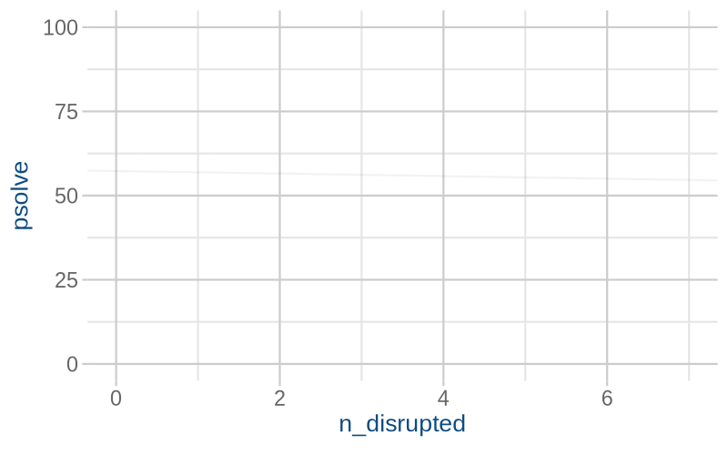
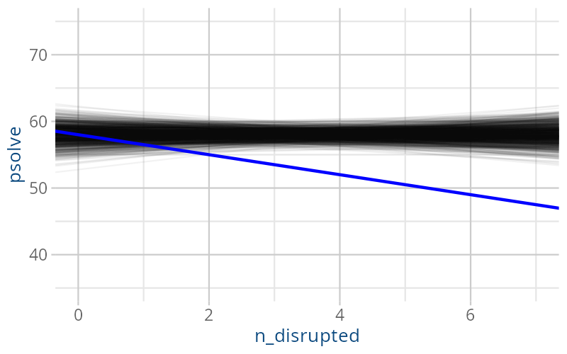
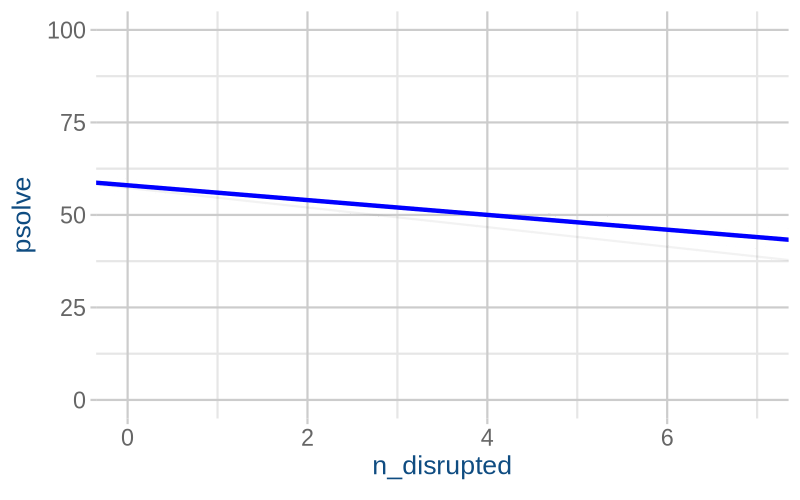
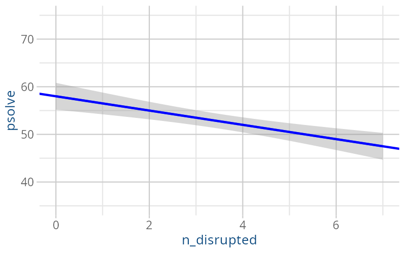
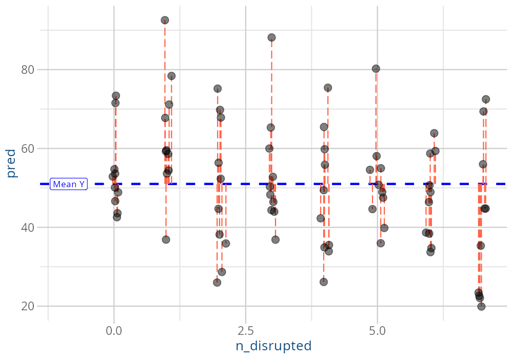
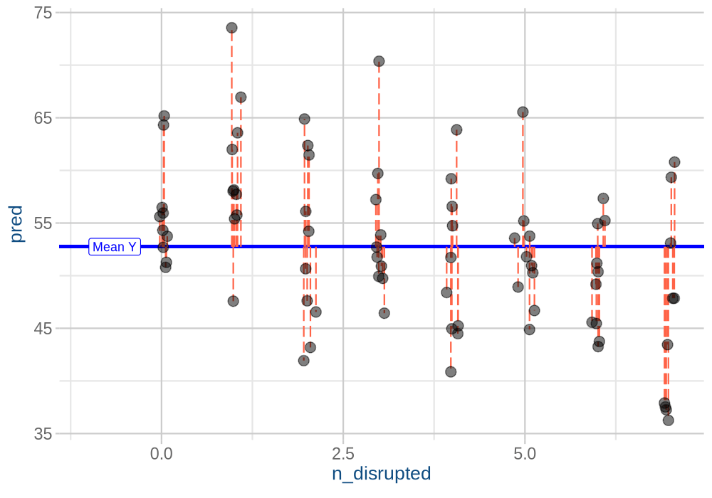

```{r}
#| label: setup
#| echo: false
library(tidyverse)
library(gganimate)
library(patchwork)
source("_theme/helpers.R")
source('_theme/theme_quarto.R')
options(digits=3)
```


# Course Overview {.smaller}
:::: {.columns}

::: {.column width="50%"}

```{r}
#| echo: false
#| warning: false
#| results: asis

block1_name = "block  1 name"
block1_lecs = c("week 1 topic",
                "week 2 topic",
                "week 3 topic",
                "week 4 topic",
                "week 5 topic")
block2_name = "block 2 name"
block2_lecs = c("week 7 topic",
                "week 8 topic",
                "week 9 topic",
                "week 10 topic",
                "week 11 topic")

source("../../../../uoepsy_other/junk/R/course_table.R")

course_table(block1_name,block2_name,block1_lecs,block2_lecs,week=11)
```

:::

::: {.column width="50%"}

```{r}
#| echo: false
#| warning: false
#| results: asis

block3_name = "block 3 name"
block3_lecs = c("week 1 topic",
                "week 2 topic",
                "week 3 topic",
                "week 4 topic",
                "week 5 topic")
block4_name = "block 4 name"
block4_lecs = c("week 7 topic",
                "week 8 topic",
                "week 9 topic",
                "week 10 topic",
                "week 11 topic")

source("../../../../uoepsy_other/junk/R/course_table.R")

course_table(block3_name,block4_name,block3_lecs,block4_lecs,week=7)
```

:::

::::

## This week

1. Where my p-values at? (tests & CIs for the intercept and slope)
3. The other bits.. 

# Where did we get to last week?

## the linear model

**The general idea:**  
$$
\begin{align}
\color{red}{\text{outcome}} &= \color{blue}{\text{model}} &+& \quad \quad \color{black}{\text{error}} \\
\end{align}
$$
**The linear model:**  
$$
\begin{align}
\color{red}{y} &= \color{blue}{\underset{\underset{\text{intercept}}{\uparrow}}{b_0} + \underset{\underset{\text{slope}}{\uparrow}}{b_1} \cdot x} & + & \quad \quad \color{black}{\epsilon}
\end{align}
$$

:::{.fragment fragment-index=1}
**The code in R:**  
```{r}
#| include: false
somedata <- tibble(
  x = round(runif(10,4,20)),
  y = round(rnorm(10,40+1*x,4))
)
# egfit <- lm(y~x,somedata)
# egsegs <- tibble(x1 = 0:6, x2 = x1+1) |> 
#   mutate(
#     y1 = map_dbl(x1,~(c(1,.)%*%coef(egfit))[1]),
#     y2 = map_dbl(x2,~(c(1,.)%*%coef(egfit))[1]),
#     xlp = (x1+x2)/2,
#     ylp = (y1+y2)/2
#   )
# 
# ggplot(somedata,aes(x=x,y=y))+
#   geom_point(alpha=.1,size=3)+
#   stat_smooth(method=lm,se=FALSE,color="#0000FF",lwd=1) +
#   geom_point(x=0,y=coef(egfit)[1],col="#0000FF",size=5)+
#   geom_segment(data = egsegs, aes(x=x1,xend=x2,y=y1,yend=y1),
#                lty="dashed",col="#0000FF")+
#   geom_segment(data = egsegs, aes(x=x2,xend=x2,y=y1,yend=y2),
#                lty="dashed",col="#0000FF") 
```
```{r}
#| echo: true
#| eval: false
my_model <- lm(y ~ 1 + x, data = somedata)

my_model
```
```
Call:
lm(formula = y ~ 1 + x, data = somedata)

Coefficients:
(Intercept)            x  
     ....           ....  
```
:::


## using models {.smaller}

```{r}
#| echo: false
set.seed(65683728)
eg1sleep <- tibble(
  person = unlist(lapply(1:5, \(x) paste0(LETTERS[x],LETTERS)))[1:80],
  n_disrupted = rep(0:7,e=10),
  psolve = (58 - 1.5 * n_disrupted) + 
    residuals(lm(rnorm(80,0,7) ~ rep(0:7,e=10)))
) |> slice_sample(prop=1)

```


> **RQ:** How does an additional night of interrupted sleep affect problem solving ability?  

What quantity will answer my question?  

- the expected change in score as "nights of disrupted sleep" increases by 1.  

::::{.columns}
:::{.column width="50%"}
```{r}
head(eg1sleep)

sleep_mdl <- lm(psolve ~ 1 + n_disrupted, data = eg1sleep)

sleep_mdl
```
:::
:::{.column width="50%"}

```{r}
#| echo: false
fitw = lm(psolve~n_disrupted,eg1sleep)

segsw <- tibble(x1 = 0:6, x2 = x1+1) |> 
  mutate(
    y1 = map_dbl(x1,~(c(1,.)%*%coef(fitw))[1]),
    y2 = map_dbl(x2,~(c(1,.)%*%coef(fitw))[1]),
    xlp = (x1+x2)/2,
    ylp = (y1+y2)/2
  )
eg1sleep |> 
  ggplot(aes(x=n_disrupted,y=psolve))+
  geom_point(size=3,col="tomato1",alpha=.5)+
  stat_smooth(method=lm,se=FALSE,color="#0000FF",lwd=1) +
  geom_point(x=0,y=coef(fitw)[1],col="#0000FF",size=5)+
  geom_segment(data = segsw, aes(x=x1,xend=x2,y=y1,yend=y1),
               lty="dashed",col="#0000FF")+
  geom_segment(data = segsw, aes(x=x2,xend=x2,y=y1,yend=y2),
               lty="dashed",col="#0000FF") +
  theme_quarto(title_font_size = 28)
```

:::
::::


# Where my p-values at?

## summary()

::::{.columns}
:::{.column width="60%"}

```{r}
summary(sleep_mdl)
```

:::
:::{.column width="40%"}
:::
::::

## Call: 

::::{.columns}
:::{.column width="60%"}

```{r}
#| eval: false
summary(sleep_mdl)
```
```{r}
#| echo: false
.pp(summary(sleep_mdl),l = list(c(1:5),0,c(8:9),0,0,0,0,0,0,0,0,0,0))
```

:::
:::{.column style="width:40%;font-size:.7em;color:#cc3363"}

<br><br>

<< tells us what model has been fitted

:::
::::

## Residuals: 

::::{.columns}
:::{.column width="60%"}

```{r}
#| eval: false
summary(sleep_mdl)
```
```{r}
#| echo: false
.pp(summary(sleep_mdl),l = list(c(1:9),0,0,0,0,0,0,0,0,0,0))
```

:::
:::{.column style="width:40%;font-size:.7em;color:#cc3363"}

<br><br><br><br>

<< summary of the "residuals"  
(observed Ys - predicted Ys)  

:::
::::


## Coefficients:

::::{.columns}
:::{.column width="60%"}

```{r}
#| eval: false
summary(sleep_mdl)
```
```{r}
#| echo: false
.pp(summary(sleep_mdl),l = list(c(1:14),0,0,0,0))
```

:::
:::{.column style="width:40%;font-size:.7em;color:#cc3363"}

<br><br><br><br><br><br><br><br>

<< predicted Y when X=0  
<< change in predicted Y when X goes from x to x+1

:::
::::

<!-- - the estimated intercept and slope of the line -->
<!-- - the $b_0$ and $b_1$ in $y = b_0 + b_1 \cdot x$ -->


## Hypotheses for coefficient tests

**The intercept:**  
$$H_0: b_0 = 0 \quad\quad\quad\quad H_1: b_0 \neq 0$$   

Often not that interesting.  
Why would we ever believe $H_0$ in first place?  

<br><br><br>

:::{.fragment}
**in our example**, $b_0 = 0$ is the hypothesis that "people with zero nights of sleep disruption will have an average score of zero on the problem solving task".  
:::

## what are the hypotheses being tested?  

**The slope:**  

$$H_0: b_1 = 0 \quad\quad\quad\quad H_1: b_1 \neq 0$$   
$b_1$ corresponds to the quantity we're interested in!  

<br><br><br>

:::{.fragment}
**in our example**, $b_1 = 0$ is the hypothesis that "as the number of nights of disrupted sleep increases by 1, the average score on the problem solving task won't change".  
:::

## under the null hypothesis

```{r}
#| include: false
#| eval: false
sims = MASS::mvrnorm(n=1000,mu=c(coef(sleep_mdl)[1],0),
                     Sigma = vcov(sleep_mdl)) |>
  as.data.frame() |>
  rename(int = `(Intercept)`,slp = V2) |>
  mutate(sim_id = row_number())

p <- ggplot(eg1sleep, aes(x = n_disrupted,y=psolve))+
  geom_point(alpha=0)+
  geom_abline(data = sims, aes(intercept = int, slope = slp), alpha=.05)+
  transition_states(sim_id, transition_length = 0, state_length = 1) +
  shadow_mark(past = TRUE, alpha = 0.2) +
  ylim(35,75)

animp <- animate(p, nframes = 500,
        fps = 4, end_pause = 45, res=150,
        width = 800, height = 500, 
        renderer = gifski_renderer())

anim_save("jk_sandbox/null_lines.gif", animp)

sims = MASS::mvrnorm(n=1000,mu=c(coef(sleep_mdl)[1],0),
                     Sigma = vcov(sleep_mdl)) |>
  as.data.frame() |>
  rename(int = `(Intercept)`,slp = V2)

ggplot(eg1sleep, aes(x = n_disrupted,y=psolve))+
  geom_point(alpha=0)+
  geom_abline(data = sims, aes(intercept = int, slope = slp), alpha=.05)+
  geom_abline(intercept=coef(sleep_mdl)[1],slope=coef(sleep_mdl)[2],
              col="blue",lwd=1)+
  ylim(35,75)


ggsave(filename = "jk_sandbox/null_lines2.png",
  plot = last_plot(), width = 800 / 150,
  height = 500 / 150, dpi = 150)
```

::::{.columns}
:::{.column width="50%"}

- In a pretend universe where $b_1 = 0$ for the *population*.  
  
- What would lines from samples of 80 people look like in that universe?  

:::{.fragment fragment-index=1}
- What did we actually see?  
:::

:::
:::{.column width="50%"}

:::{.r-stack}



:::{.fragment fragment-index=1}

:::
:::

:::
::::


## A confidence interval

```{r}
#| include: false
#| eval: false
sims = MASS::mvrnorm(n=1000,mu=coef(sleep_mdl),
                     Sigma = vcov(sleep_mdl)) |>
  as.data.frame() |>
  rename(int = `(Intercept)`,slp = n_disrupted) |>
  mutate(sim_id = row_number())

p <- ggplot(eg1sleep, aes(x = n_disrupted,y=psolve))+
  geom_point(alpha=0)+
  geom_abline(data = sims, aes(intercept = int, slope = slp), alpha=.05)+
  geom_abline(intercept=coef(sleep_mdl)[1],slope=coef(sleep_mdl)[2],
              col="blue",lwd=1)+
  transition_states(sim_id, transition_length = 0, state_length = 1) +
  shadow_mark(past = TRUE, alpha = 0.2) +
  ylim(35,75)

animp <- animate(p, nframes = 500,
        fps = 4, end_pause = 45, res=150,
        width = 800, height = 500, 
        renderer = gifski_renderer())

anim_save("jk_sandbox/ci_lines.gif", animp)

ggplot(eg1sleep, aes(x = n_disrupted,y=psolve))+
  geom_smooth(method = lm)+
  geom_abline(intercept=coef(sleep_mdl)[1],
              slope=coef(sleep_mdl)[2],
              col="blue",lwd=1)+
  ylim(35,75)

ggsave(filename = "jk_sandbox/ci_lines2.png",
  plot = last_plot(), width = 800 / 150,
  height = 500 / 150, dpi = 150)
```

::::{.columns}
:::{.column width="50%"}
Using that same estimated uncertainty:  

:::{.fragment fragment-index=1}
```{r}
#| eval: false
ggplot(eg1sleep, aes(x = n_disrupted,y=psolve))+
  geom_smooth(method = lm)+
  ylim(35,75)
```
:::

:::
:::{.column width="50%"}

:::{.r-stack}


:::{.fragment fragment-index=1}

:::

:::
:::
::::


:::{.fragment fragment-index=2}
```{r}
confint(sleep_mdl)
```
:::


## What if I change the scale of X?  

::::{.columns}
:::{.column width="50%"}
```{r}
head(eg1sleep)
```


:::
:::{.column width="50%"}

```{r}
#| echo: false
ggplot(eg1sleep, aes(x = n_disrupted,y=psolve))+
  geom_point(alpha=.5,size=3)+
  geom_smooth(method = lm)+
  scale_x_continuous(breaks=0:7)+
  ylim(35,75)+
  theme_quarto(title_font_size = 28)
```

:::
::::

```{r}
#| eval: false
sleep_mdl <- lm(psolve ~ 1 + n_disrupted, data = eg1sleep)

summary(sleep_mdl)
```
```{r}
#| echo: false
.pp(summary(sleep_mdl),l = list(0,c(8:12),0))
```

## What if I change the scale of X?  

::::{.columns}
:::{.column width="50%"}
```{r}
eg1sleep <- eg1sleep |>
  mutate( wks_disrupted = n_disrupted/7 )

head(eg1sleep)
```

:::
:::{.column width="50%"}

```{r}
#| echo: false
ggplot(eg1sleep, aes(x = wks_disrupted,y=psolve))+
  geom_point(alpha=.5,size=3)+
  geom_smooth(method = lm)+
  scale_x_continuous(breaks=seq(0,1,.25))+
  ylim(35,75)+
  theme_quarto(title_font_size = 28)
```

:::
::::


```{r}
#| eval: false
sleep_mdl2 <- lm(psolve ~ 1 + wks_disrupted, data = eg1sleep)

summary(sleep_mdl2)
```

:::{.fragment}
```{r}
#| echo: false
sleep_mdl2 <- lm(psolve ~ 1 + wks_disrupted, data = eg1sleep)
.pp(summary(sleep_mdl2),l = list(0,c(8:12),0))
```
:::


## Write up

> We fit a simple linear regression model to estimate whether the number of nights of disrupted sleep would predict scores on a problem solving task. <span style="opacity:.4">The model was statistically significant, F(1, 48) = 25.42, p < .001, accounting for 20% of the variance in problem solving scores ($R^2=0.201$).</span> More sleep disruption significantly predicted poorer problem solving ($b = -1.5, SE = 0.34, t(78)=-4.43, p<.001$), with a 95% confidence interval of [-2.17, -0.83], indicating that for every additional night of disrupted sleep, scores on the puzzle solving task decreased on average by 1.5 points.


# the other bits


## stuff at the bottom

::::{.columns}
:::{.column width="60%"}

```{r}
#| eval: false
summary(sleep_mdl)
```
```{r}
#| echo: false
.pp(summary(sleep_mdl),l = list(c(1:2),c(4:5),0,c(8:9),0,0,0,0,0,0,16:19))
```

:::
:::{.column style="width:40%;font-size:.7em;color:#cc3363"}

<br><br><br><br><br><br><br><br><br><br><br><br><br>

- Instead of individual parameters, it is about the model as a whole.  
- Does the model account for why the outcome varies (values are sometimes high, sometimes low)? How much variation does it account for?  

:::
::::


## warning - this is all pointless (for now) {.smaller}

- For DAPR1, we're working with models that have just one predictor. 
    - the "model as a whole" = just one line!  

<br>

- looking ahead to DAPR2: `outcome ~ predictor1 + predictor2`  
    - it might on occasion be useful to ask if \{set of predictors\} explains stuff in Y. 


<br>

:::{.dapr1callout}
We'll cover this stuff again next year, but we're going through it here because   

- it gets printed out, so I'm sure some of you are curious   
- when you hear about it next year, things might click a bit more/feel vaguely familiar!  

!! This stuff will **not** be in any skills Qs in DAPR1 !!
:::


## All the variance in the outcome

```{r}
#| echo: false
#| eval: false
set.seed(346)
p1 <- eg1sleep |>
  mutate(
         my = mean(psolve),
         f1 = mean(psolve),
         f2 = predict(sleep_mdl),
         xjit = rnorm(n(),n_disrupted,.05)) |>
  pivot_longer(f1:f2,names_to="frame",values_to="pred") |>
  filter(frame=="f1") |>
  ggplot(aes(x=xjit,y=psolve))+
  geom_hline(yintercept = mean(eg1sleep$psolve),
             col="blue",lwd=1,alpha=1,lty="dashed")+
  # geom_abline(intercept=coef(sleep_mdl)[1],
  #             slope=coef(sleep_mdl)[2],
  #             col="blue",lwd=1)+
  geom_segment(aes(x=xjit,xend=xjit,
                   y=pred,yend=my),
               col="black",lty="solid",lwd=.5)+
  geom_segment(aes(x=xjit,xend=xjit,
                   y=pred,yend=psolve),
               col="tomato1",lty="longdash",lwd=.5)+
  geom_point(size=3, alpha=.5)+
  annotate("label",x=-1, y=mean(eg1sleep$psolve),label="Mean Y",
           size=3,col="blue",hjust=.3) + 
  labs(x="n_disrupted")

ggsave(filename = "jk_sandbox/rssplot.png",
  plot = last_plot(), width = 1000 / 150,
  height = 700 / 150, dpi = 150)
```




## aside: the mean is a model! 

::::{.columns}
:::{.column width="50%"}
The simplest possible model.  

- "intercept-only model":  
- the best guess for any observation's value of Y is `mean(y)`

  
```{r}
sleep_mdl0 <- lm(psolve ~ 1, data = eg1sleep)

sleep_mdl0
```
:::
:::{.column width="50%" .fragment}
```{r}
eg1sleep |>
  summarise(
    meanpsolve = mean(psolve)
  )
```
:::

::::


## explaining variance in the outcome

```{r}
#| include: false
#| eval: false

set.seed(346)
p_anim <-
  eg1sleep |>
  mutate(
         my = mean(psolve),
         f1 = mean(psolve),
         f2 = predict(sleep_mdl),
         xjit = rnorm(n(),n_disrupted,.05)) |>
  pivot_longer(f1:f2,names_to="frame",values_to="pred") |>
  mutate(int = ifelse(frame=="f1",my,coef(sleep_mdl)[1]),
         slp = ifelse(frame=="f1",0,coef(sleep_mdl)[2])) |>
  #filter(frame=="f2") |>
  ggplot(aes(x=xjit,y=psolve))+
  geom_hline(yintercept = mean(eg1sleep$psolve),
             col="blue",lwd=1,alpha=1,lty="dashed")+
  geom_abline(aes(intercept=int,slope=slp),
              col="blue",lwd=1)+
  geom_segment(aes(x=xjit,xend=xjit,
                   y=pred,yend=psolve),
               col="tomato1",lty="longdash",lwd=.5)+
  geom_segment(aes(x=xjit,xend=xjit,
                   y=pred,yend=my),
               col="black",lty="solid",lwd=.5)+
  annotate("label",x=-1, y=mean(eg1sleep$psolve),label="Mean Y",
           size=3,col="blue",hjust=0) + 
  geom_point(size=3, alpha=.5)+
  labs(x="n_disrupted") + 
  transition_states(frame, transition_length = 2, state_length = 1)

animp <- animate(p_anim, nframes = 180,
        fps = 15, end_pause = 45, res=150,
        width = 1000, height = 700, 
        renderer = gifski_renderer())

anim_save("jk_sandbox/ssmodel.gif",animp)
```

:::{.r-stack}


:::{.fragment}

:::
:::

- red lines = residual/unexplained  
- black lines = model explained  

## $R^2$


::::{.columns}
:::{.column width="60%"}

```{r}
#| eval: false
summary(sleep_mdl)
```
```{r}
#| echo: false
.pp(summary(sleep_mdl),l = list(c(1:2),c(4:5),0,c(8:9),0,0,0,0,0,0,0,17,0))
```

:::
:::{.column style="width:40%;font-size:.7em;color:#cc3363"}

<br><br><br><br><br><br><br><br><br><br><br><br><br>


the "proportion of variance in Y accounted for by X"  
$\frac{\text{explained}}{\text{explained} + \text{unexplained}}$


:::
::::

## Residual standard deviation

::::{.columns}
:::{.column width="60%"}

```{r}
#| eval: false
summary(sleep_mdl)
```
```{r}
#| echo: false
.pp(summary(sleep_mdl),l = list(c(1:2),c(4:5),0,c(8:9),0,0,0,0,0,0,16,0,0))
```

:::
:::{.column style="width:40%;font-size:.7em;color:#cc3363"}

<br><br><br><br><br><br><br><br><br><br><br><br><br>

standard deviation of all the residuals/leftover bits. 

:::
::::


## degrees of freedom? {width=150px} 

- We have 80 datapoints.  

- We've used 2 things (an intercept and a slope across X) to explain some of the variance in Y

- The leftover unexplained variance in Y is created by $n-2$ things.  

- why $n-2$?  
- we can place $n-2$ of the datapoints *absolutely anywhere*, and still get the same line by fixing the last 2 datapoints.  
    - think "give me 5 numbers that add up to 100" --- once you've chosen the first 4 numbers, you have no free choice for the last one!  

- this idea is referred to as "degrees of freedom"  


```{r}
#| echo: false
#| eval: false
#| fig-asp: .6
#| fig-align: center

## function to work out the "last two" points on for a given best fit
## line, by working out the residuals for given x and y
## (maths courtesy of Umberto Noè)
require(patchwork)

plot_dat <- function() {
  # solve for y=5x+2
  x1=1
  x2=11
  a_given=-7.5
  b_given=3
  
  randline <- function (x) {
    a<-runif(1,-5,5)
    b<-runif(1,-3,7)
    y<-a+b*x+runif(length(x),-20,20)
  }
  
  x = sample(0:12,8)
  y = randline(x)
  x <- c(x,x1,x2)
  
  loss_function <- function(y_new) {
    y_complete <- c(y, y_new[1], y_new[2])
    fit <- lm(y_complete ~ x)
    a_diff <- (fit$coefficients[1] - a_given)^2
    b_diff <- (fit$coefficients[2] - b_given)^2
    return(a_diff + b_diff)
  }

  # Use optimization to find y1 and y2
  result <- optim(c(0, 0), loss_function)
  
  # Extract y1 and y2
  y1 <- result$par[1]
  y2 <- result$par[2]
  
  pd <- tibble(x=x,y=c(y,y1,y2),colour=c(rep("a",8),rep("b",2)))

  return(pd)
}

pd1 <- plot_dat()
pd2 <- plot_dat()
pd3 <- plot_dat()
pd4 <- plot_dat()

yr<-range(c(pd1$y[pd1$colour=="a"],pd2$y[pd2$colour=="a"],pd3$y[pd3$colour=="a"],pd4$y[pd4$colour=="a"]))
yr2<-range(c(pd1$y,pd2$y,pd3$y,pd4$y))


do_p <- function(x) {
x |> ggplot(aes(x=x,y=y)) +
  geom_point(aes(colour=colour),size=3) +
  xlim(c(0,15)) +
    ylim(yr2) +
  scale_colour_manual(values=c('a'='darkgrey','b'='red')) +
  theme(legend.position = "none") +
  geom_smooth(method="lm",se=FALSE)
}

p1 <- do_p(pd1)
p2 <- do_p(pd2)
p3 <- do_p(pd3)
p4 <- do_p(pd4)
(p1 + p2) / (p3 + p4)
```

## The F bit

::::{.columns}
:::{.column width="60%"}

```{r}
#| eval: false
summary(sleep_mdl)
```
```{r}
#| echo: false
.pp(summary(sleep_mdl),l = list(c(1:2),c(4:5),0,c(8:9),0,0,0,0,0,0,0,0,18:19))
```

:::
:::{.column style="width:40%;font-size:.7em;color:#cc3363"}

<br><br><br><br><br><br><br><br><br><br><br><br><br>

does the addition of the predictor to the model explain more variance than would expect by chance?  

adding the predictor = adding 1 slope, and explaining some variance

$\frac{\text{explained variance}/1}{\text{unexplained variance}/n-2}$

:::
::::


## it's all the same! 

::::{.columns}
:::{.column width="60%"}

```{r}
#| eval: false
summary(sleep_mdl)
```
```{r}
#| echo: false
.pp(summary(sleep_mdl),l = list(c(1:2),c(4:5),0,c(8:14),0,0,18:19))
```

:::
:::{.column style="width:40%;font-size:.7em;color:#cc3363"}

<br><br><br><br><br><br><br><br>

as the slope moves away from being horizontal ($b_1=0$)..

<br><br><br><br>

it explains variance... 

even the p-value is identical

:::
::::

## pop quiz..

<br><br>
What is $R^2$ for `lm(y~1)`? 


## Block 4 skills involved in this week's lecture and/or workshop

- **A8** I can appropriately interpret the parameters of a simple linear model.
- **I8** I can identify the null hypothesis being tested for the parameters of a linear model.
- **C3** I can describe in writing the results of a given simple linear model.


<!-- - **A7** I can use a fitted simple linear model to predict an outcome value for a given predictor value -->
<!-- - **A8** I can appropriately interpret the parameters of a simple linear model. -->
<!-- - **A9** I can explain how both a t-test and a correlation can be expressed as a linear model. -->
<!-- - **A10** I can represent binary predictors using treatment coding. -->
<!-- - **C3** I can describe in writing the results of a given simple linear model. -->
<!-- - **I8** I can identify the null hypothesis being tested for the parameters of a linear model. -->
<!-- - **V5** I can visually estimate the parameters of a line from a plot. -->


