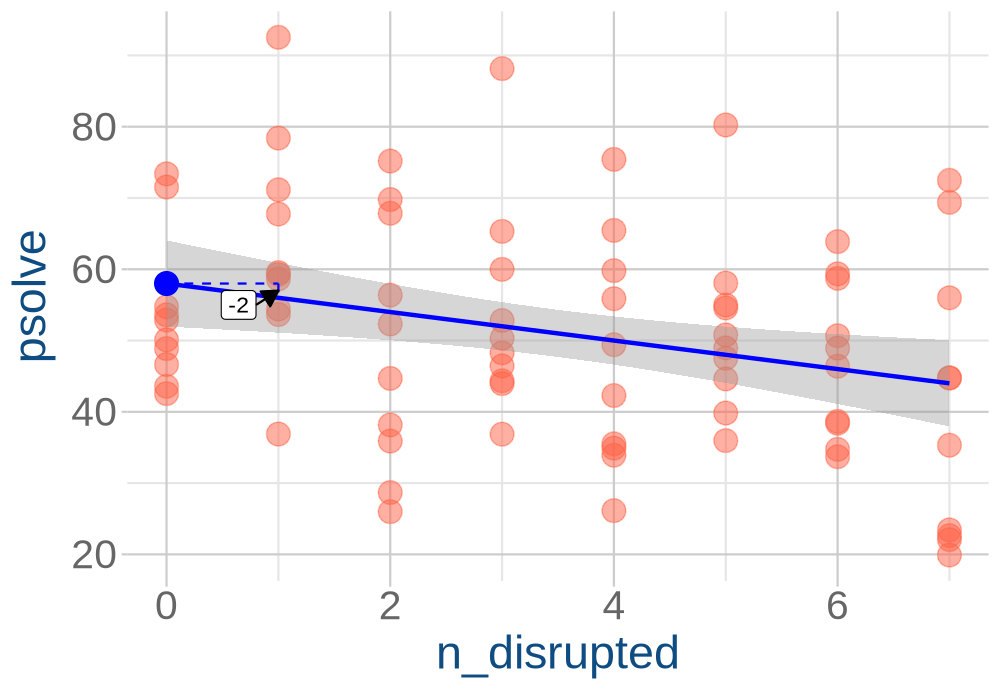

```{r}
#| label: setup
#| echo: false
library(tidyverse)
library(gganimate)
library(patchwork)
source("_theme/helpers.R")
source('_theme/theme_quarto.R')
options(digits=4)
```


# Course Overview {.smaller}
:::: {.columns}

::: {.column width="50%"}

```{r}
#| echo: false
#| warning: false
#| results: asis

block1_name = "block  1 name"
block1_lecs = c("week 1 topic",
                "week 2 topic",
                "week 3 topic",
                "week 4 topic",
                "week 5 topic")
block2_name = "block 2 name"
block2_lecs = c("week 7 topic",
                "week 8 topic",
                "week 9 topic",
                "week 10 topic",
                "week 11 topic")

source("../../../../uoepsy_other/junk/R/course_table.R")

course_table(block1_name,block2_name,block1_lecs,block2_lecs,week=11)
```

:::

::: {.column width="50%"}

```{r}
#| echo: false
#| warning: false
#| results: asis

block3_name = "block 3 name"
block3_lecs = c("week 1 topic",
                "week 2 topic",
                "week 3 topic",
                "week 4 topic",
                "week 5 topic")
block4_name = "block 4 name"
block4_lecs = c("week 7 topic",
                "week 8 topic",
                "week 9 topic",
                "week 10 topic",
                "week 11 topic")

source("../../../../uoepsy_other/junk/R/course_table.R")

course_table(block3_name,block4_name,block3_lecs,block4_lecs,week=7)
```

:::

::::

## This week

1. Where my p-values at? (tests & CIs for the intercept and slope)
2. What happens when we change the scale of our variables? 

# Where did we get to last week?

## the linear model

**The general idea:**  
$$
\begin{align}
\color{red}{\text{outcome}} &= \color{blue}{\text{model}} &+& \quad \quad \color{black}{\text{error}} \\
\end{align}
$$
**The linear model:**  
$$
\begin{align}
\color{red}{y} &= \color{blue}{\underset{\underset{\text{intercept}}{\uparrow}}{b_0} + \underset{\underset{\text{slope}}{\uparrow}}{b_1} \cdot x} & + & \quad \quad \color{black}{\epsilon}
\end{align}
$$

:::{.fragment fragment-index=1}
**The code in R:**  
```{r}
#| include: false
somedata <- tibble(
  x = round(runif(10,4,20)),
  y = round(rnorm(10,40+1*x,4))
)
# egfit <- lm(y~x,somedata)
# egsegs <- tibble(x1 = 0:6, x2 = x1+1) |> 
#   mutate(
#     y1 = map_dbl(x1,~(c(1,.)%*%coef(egfit))[1]),
#     y2 = map_dbl(x2,~(c(1,.)%*%coef(egfit))[1]),
#     xlp = (x1+x2)/2,
#     ylp = (y1+y2)/2
#   )
# 
# ggplot(somedata,aes(x=x,y=y))+
#   geom_point(alpha=.1,size=3)+
#   stat_smooth(method=lm,se=FALSE,color="#0000FF",lwd=1) +
#   geom_point(x=0,y=coef(egfit)[1],col="#0000FF",size=5)+
#   geom_segment(data = egsegs, aes(x=x1,xend=x2,y=y1,yend=y1),
#                lty="dashed",col="#0000FF")+
#   geom_segment(data = egsegs, aes(x=x2,xend=x2,y=y1,yend=y2),
#                lty="dashed",col="#0000FF") 
```
```{r}
#| echo: true
#| eval: false
my_model <- lm(y ~ 1 + x, data = somedata)

my_model
```
```
Call:
lm(formula = y ~ 1 + x, data = somedata)

Coefficients:
(Intercept)            x  
     ....           ....  
```
:::


## using models {.smaller}

```{r}
#| echo: false
source("egsleeps.R")
```


> **RQ:** How does an additional night of interrupted sleep affect problem solving ability?  

What quantity will answer my question?  

- the expected change in score as "nights of disrupted sleep" increases by 1.  

::::{.columns}
:::{.column width="50%"}
```{r}
head(eg1sleep)

sleep_mdl <- lm(psolve ~ 1 + n_disrupted, data = eg1sleep)

sleep_mdl
```
:::
:::{.column width="50%"}

```{r}
#| echo: false
fitw = lm(psolve~n_disrupted,eg1sleep)

segsw <- tibble(x1 = 0:6, x2 = x1+1) |> 
  mutate(
    y1 = map_dbl(x1,~(c(1,.)%*%coef(fitw))[1]),
    y2 = map_dbl(x2,~(c(1,.)%*%coef(fitw))[1]),
    xlp = (x1+x2)/2,
    ylp = (y1+y2)/2
  )
eg1sleep |> 
  ggplot(aes(x=n_disrupted,y=psolve))+
  geom_point(size=3,col="tomato1",alpha=.5)+
  stat_smooth(method=lm,se=FALSE,color="#0000FF",lwd=1) +
  geom_point(x=0,y=coef(fitw)[1],col="#0000FF",size=5)+
  geom_segment(data = segsw, aes(x=x1,xend=x2,y=y1,yend=y1),
               lty="dashed",col="#0000FF")+
  geom_segment(data = segsw, aes(x=x2,xend=x2,y=y1,yend=y2),
               lty="dashed",col="#0000FF") +
  theme_quarto(title_font_size = 28)
```

:::
::::


# Where my p-values at?

## summary()

::::{.columns}
:::{.column width="60%"}

```{r}
summary(sleep_mdl)
```

:::
:::{.column width="40%"}
:::
::::

## Call: 

::::{.columns}
:::{.column width="60%"}

```{r}
#| eval: false
summary(sleep_mdl)
```
```{r}
#| echo: false
.pp(summary(sleep_mdl),l = list(c(1:5),0,c(8:9),0,0,0,0,0,0,0,0,0,0))
```

:::
:::{.column style="width:40%;font-size:.7em;color:#cc3363"}

<br><br>

<< tells us what model has been fitted

:::
::::

## Residuals: 

::::{.columns}
:::{.column width="60%"}

```{r}
#| eval: false
summary(sleep_mdl)
```
```{r}
#| echo: false
.pp(summary(sleep_mdl),l = list(c(1:9),0,0,0,0,0,0,0,0,0,0))
```

:::
:::{.column style="width:40%;font-size:.7em;color:#cc3363"}

<br><br><br><br>

<< summary of the "residuals"  
(observed Ys - predicted Ys)  

:::
::::


## Coefficients:

::::{.columns}
:::{.column width="60%"}

```{r}
#| eval: false
summary(sleep_mdl)
```
```{r}
#| echo: false
.pp(summary(sleep_mdl),l = list(c(1:14),0,0,0,0))
```

:::
:::{.column style="width:40%;font-size:.7em;color:#cc3363"}

<br><br><br><br><br><br><br><br>

<< predicted Y when X=0  
<< change in predicted Y when X goes from x to x+1

:::
::::

<!-- - the estimated intercept and slope of the line -->
<!-- - the $b_0$ and $b_1$ in $y = b_0 + b_1 \cdot x$ -->


## Hypotheses tests for coefficients (1)

**The intercept:**  
$$H_0: b_0 = 0 \quad\quad\quad\quad H_1: b_0 \neq 0$$   

**in our example**, $b_0 = 0$ is the hypothesis that "people with zero nights of sleep disruption will have an average score of zero on the problem solving task".  

<br><br><br>

:::{.fragment}
Often not that interesting.  
Why would we ever believe $H_0$ in first place?  
:::

## Hypotheses tests for coefficients (2)

**The slope:**  

$$H_0: b_1 = 0 \quad\quad\quad\quad H_1: b_1 \neq 0$$   

**in our example**, $b_1 = 0$ is the hypothesis that "as the number of nights of disrupted sleep increases by 1, the average score on the problem solving task won't change".  

<br><br><br>

:::{.fragment}
$b_1$ corresponds to the quantity we're interested in!  
:::

## under the null hypothesis

```{r}
#| include: false
#| eval: false
sims = MASS::mvrnorm(n=1000,mu=c(coef(sleep_mdl)[1],0),
                     Sigma = vcov(sleep_mdl)) |>
  as.data.frame() |>
  rename(int = `(Intercept)`,slp = V2) |>
  mutate(sim_id = row_number())

p <- ggplot(eg1sleep, aes(x = n_disrupted,y=psolve))+
  geom_point(alpha=0)+
  geom_abline(data = sims, aes(intercept = int, slope = slp), alpha=.05)+
  transition_states(sim_id, transition_length = 0, state_length = 1) +
  shadow_mark(past = TRUE, alpha = 0.2) +
  ylim(0,100)

animp <- animate(p, nframes = 500,
        fps = 4, end_pause = 45, res=150,
        width = 800, height = 500, 
        renderer = gifski_renderer())

anim_save("jk_sandbox/null_lines.gif", animp)

sims = MASS::mvrnorm(n=1000,mu=c(coef(sleep_mdl)[1],0),
                     Sigma = vcov(sleep_mdl)) |>
  as.data.frame() |>
  rename(int = `(Intercept)`,slp = V2)

ggplot(eg1sleep, aes(x = n_disrupted,y=psolve))+
  geom_point(alpha=0)+
  geom_abline(data = sims, aes(intercept = int, slope = slp), alpha=.05)+
  geom_abline(intercept=coef(sleep_mdl)[1],slope=coef(sleep_mdl)[2],
              col="blue",lwd=1)+
  ylim(0,100)


ggsave(filename = "jk_sandbox/null_lines2.png",
  plot = last_plot(), width = 800 / 150,
  height = 500 / 150, dpi = 150)
```

::::{.columns}
:::{.column width="50%"}

- In a pretend universe where $b_1 = 0$ for the *population*.  
  
- What would lines from samples of 80 people look like in that universe?  

:::{.fragment fragment-index=1}
- What did we actually see?  
:::

:::
:::{.column width="50%"}

:::{.r-stack}


:::{.fragment fragment-index=1}

:::
:::

:::
::::


## A confidence interval

```{r}
#| include: false
#| eval: false
sims = MASS::mvrnorm(n=1000,mu=coef(sleep_mdl),
                     Sigma = vcov(sleep_mdl)) |>
  as.data.frame() |>
  rename(int = `(Intercept)`,slp = n_disrupted) |>
  mutate(sim_id = row_number())

p <- ggplot(eg1sleep, aes(x = n_disrupted,y=psolve))+
  geom_point(alpha=0)+
  geom_abline(data = sims, aes(intercept = int, slope = slp), alpha=.05)+
  geom_abline(intercept=coef(sleep_mdl)[1],slope=coef(sleep_mdl)[2],
              col="blue",lwd=1)+
  transition_states(sim_id, transition_length = 0, state_length = 1) +
  shadow_mark(past = TRUE, alpha = 0.2) +
  ylim(0,100)

animp <- animate(p, nframes = 500,
        fps = 4, end_pause = 45, res=150,
        width = 800, height = 500, 
        renderer = gifski_renderer())

anim_save("jk_sandbox/ci_lines.gif", animp)

ggplot(eg1sleep, aes(x = n_disrupted,y=psolve))+
  geom_smooth(method = lm)+
  geom_abline(intercept=coef(sleep_mdl)[1],
              slope=coef(sleep_mdl)[2],
              col="blue",lwd=1)+
  ylim(0,100)

ggsave(filename = "jk_sandbox/ci_lines2.png",
  plot = last_plot(), width = 800 / 150,
  height = 500 / 150, dpi = 150)
```

::::{.columns}
:::{.column width="50%"}
Using that same estimated uncertainty:  

:::{.fragment fragment-index=1}
```{r}
#| eval: false
ggplot(eg1sleep, aes(x = n_disrupted,y=psolve))+
  geom_smooth(method = lm)
```
:::

:::
:::{.column width="50%"}

:::{.r-stack}


:::{.fragment fragment-index=1}

:::

:::
:::
::::


:::{.fragment fragment-index=2}
```{r}
confint(sleep_mdl)
```
:::

## Write up

> We fit a simple linear regression model to estimate whether the number of nights of disrupted sleep would predict scores on a problem solving task. More sleep disruption significantly predicted poorer problem solving ($b = -2.0, SE = 0.73, t(78)=-2.76, p=.007$), with a 95% confidence interval of [-3.45, -0.55], indicating that for every additional night of disrupted sleep, scores on the puzzle solving task decreased on average by 2 points.


# Changing scales  

## What if we change the scale of variables?    

::::{.columns}
:::{.column width="50%"}
```{r}
head(eg1sleep)
```


:::
:::{.column width="50%"}

```{r}
#| echo: false
ggplot(eg1sleep, aes(x = n_disrupted,y=psolve))+
  geom_point(size=3,col="tomato1",alpha=.5)+
  geom_smooth(method = lm)+
  scale_x_continuous(breaks=0:7)+
  ylim(0,100) +
  theme_quarto(title_font_size = 28)
```

:::
::::

```{r}
#| eval: false
sleep_mdl <- lm(psolve ~ 1 + n_disrupted, data = eg1sleep)

summary(sleep_mdl)
```
```{r}
#| echo: false
.pp(summary(sleep_mdl),l = list(0,c(8:12),0))
```

## What if we change the scale of X?  

::::{.columns}
:::{.column width="50%"}
```{r}
eg1sleep <- eg1sleep |>
  mutate( wks_disrupted = n_disrupted/7 )

head(eg1sleep)
```

:::
:::{.column width="50%"}

```{r}
#| echo: false
ggplot(eg1sleep, aes(x = wks_disrupted,y=psolve))+
  geom_point(size=3,col="tomato1",alpha=.5)+
  geom_smooth(method = lm)+
  scale_x_continuous(breaks=seq(0,1,.25))+
  ylim(0,100) +
  theme_quarto(title_font_size = 28)
```

:::
::::


```{r}
#| eval: false
sleep_mdl2 <- lm(psolve ~ 1 + wks_disrupted, data = eg1sleep)

summary(sleep_mdl2)
```

:::{.fragment}
```{r}
#| echo: false
sleep_mdl2 <- lm(psolve ~ 1 + wks_disrupted, data = eg1sleep)
.pp(summary(sleep_mdl2),l = list(0,c(8:12),0))
```
:::


## What if we change the scale of Y?  

::::{.columns}
:::{.column width="50%"}
```{r}
eg1sleep <- eg1sleep |>
  mutate( wks_disrupted = n_disrupted/7,
          psolve2 = psolve/10 )

head(eg1sleep)
```

:::
:::{.column width="50%"}

```{r}
#| echo: false
ggplot(eg1sleep, aes(x = wks_disrupted,y=psolve2))+
  geom_point(size=3,col="tomato1",alpha=.5)+
  geom_smooth(method = lm)+
  scale_x_continuous(breaks=seq(0,1,.25))+
  ylim(0,10)+
  theme_quarto(title_font_size = 28)
```

:::
::::


```{r}
#| eval: false
sleep_mdl3 <- lm(psolve2 ~ 1 + wks_disrupted, data = eg1sleep)

summary(sleep_mdl3)
```

:::{.fragment}
```{r}
#| echo: false
sleep_mdl3 <- lm(psolve2 ~ 1 + wks_disrupted, data = eg1sleep)
.pp(summary(sleep_mdl3),l = list(0,c(8:12),0))
```
:::


## The model doesn't change, the estimated quantities do..  

```{r}
#| eval: false
#| echo: false
eg1sleep <- eg1sleep |> mutate(id = row_number())
fitw = lm(psolve~n_disrupted,eg1sleep)
segsw <- tibble(x1 = 0, x2 = x1+1) |> 
  mutate(
    y1 = map_dbl(x1,~(c(1,.)%*%coef(fitw))[1]),
    y2 = map_dbl(x2,~(c(1,.)%*%coef(fitw))[1]),
    ll = as.character(round(coef(fitw)[2],2))
  )
fitw2 = lm(psolve~I(n_disrupted/7),eg1sleep)
segsw2 <- tibble(x1 = 0, x2 = x1+1) |> 
  mutate(
    y1 = map_dbl(x1,~(c(1,.)%*%coef(fitw2))[1]),
    y2 = map_dbl(x2,~(c(1,.)%*%coef(fitw2))[1]),
    ll = as.character(round(coef(fitw2)[2],2))
  )
fitw3 = lm(I(psolve/10)~I(n_disrupted/7),eg1sleep)
segsw3 <- tibble(x1 = 0, x2 = x1+1) |> 
  mutate(
    y1 = map_dbl(x1,~(c(1,.)%*%coef(fitw3))[1]),
    y2 = map_dbl(x2,~(c(1,.)%*%coef(fitw3))[1]),
    ll = as.character(round(coef(fitw3)[2],3))
  )
dff <- bind_rows(
  eg1sleep, 
  eg1sleep |> mutate(n_disrupted = n_disrupted/7,
                     psolve = psolve),
  eg1sleep |> mutate(n_disrupted = n_disrupted/7,
                      psolve = psolve/10),
  .id = "frame"
)
segsw <- segsw |> mutate(seg_id = row_number())
segsw2 <- segsw2 |> mutate(seg_id = row_number())
segsw3 <- segsw3 |> mutate(seg_id = row_number())

sdf <- bind_rows(
  segsw, 
  segsw2,
  segsw3,
  .id = "frame"
)


p_anim <- dff |> 
  ggplot(aes(x=n_disrupted,y=psolve))+
  geom_point( aes(group = id),size=5,col="tomato1",alpha=.5)+
  stat_smooth(method=lm,color="#0000FF",lwd=1) +
  geom_point(data = sdf |> filter(x1==0),
             aes(x=0,y=y1),col="#0000FF",size=5)+
  geom_segment(data = sdf, aes(x=x1,xend=x2,y=y1,yend=y1,group=seg_id),
               lty="dashed",col="#0000FF")+
  geom_segment(data = sdf, aes(x=x2,xend=x2,y=y1,yend=y2,group=seg_id),
               lty="dashed",col="#0000FF") +
  geom_label(data = sdf, 
             aes(x = 0.8, y=(y1-1.5*abs(y2-y1)), label=ll),hjust=1) + 
  geom_curve(data = sdf, 
             aes(x = 0.8, y = (y1-1.5*abs(y2-y1)), 
                 xend = 1, yend = (y1+(y2-y1)/2)),
    arrow = arrow(length = unit(0.3, "cm"), 
                  type = "closed"),
    color = "black",
    curvature = 0
  ) +
  theme_quarto(title_font_size = 28)+
  labs(
    x = "{ifelse(closest_state == 1, 'n_disrupted',
            'n_disrupted/7')}",
    y = "{ifelse(closest_state <= 1, 'psolve',
            'psolve/10')}"
  )+
  transition_states(frame, transition_length = 2, state_length = 6) +
  view_follow(fixed_x = FALSE, fixed_y = FALSE)

animp <- animate(p_anim, nframes = 150,
        fps = 15, end_pause = 15, res=150,
        width = 1000, height = 700, 
        renderer = gifski_renderer())

anim_save("jk_sandbox/line_scaling.gif", animp)
```




## Block 4 skills involved in this week's lecture and/or workshop

- **A8** I can appropriately interpret the parameters of a simple linear model.
- **I8** I can identify the null hypothesis being tested for the parameters of a linear model.
- **C3** I can describe in writing the results of a given simple linear model.


<!-- - **A7** I can use a fitted simple linear model to predict an outcome value for a given predictor value -->
<!-- - **A8** I can appropriately interpret the parameters of a simple linear model. -->
<!-- - **A9** I can explain how both a t-test and a correlation can be expressed as a linear model. -->
<!-- - **A10** I can represent binary predictors using treatment coding. -->
<!-- - **C3** I can describe in writing the results of a given simple linear model. -->
<!-- - **I8** I can identify the null hypothesis being tested for the parameters of a linear model. -->
<!-- - **V5** I can visually estimate the parameters of a line from a plot. -->


