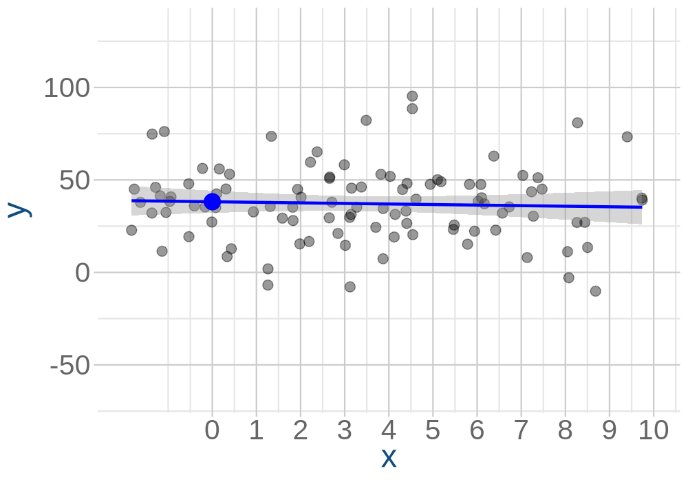
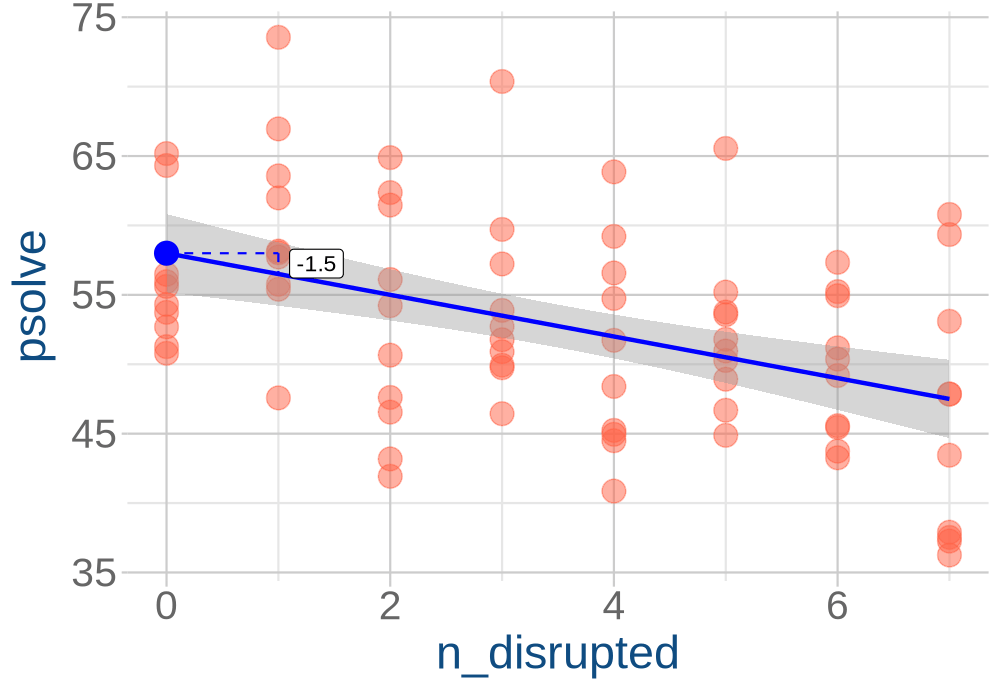

```{r}
#| label: setup
#| echo: false
library(tidyverse)
library(gganimate)
library(patchwork)
source("_theme/helpers.R")
source('_theme/theme_quarto.R')
options(digits=4)
options(scipen=4)
source("egsleeps.R")
```


# Course Overview {.smaller}
:::: {.columns}

::: {.column width="50%"}

```{r}
#| echo: false
#| warning: false
#| results: asis

block1_name = "block  1 name"
block1_lecs = c("week 1 topic",
                "week 2 topic",
                "week 3 topic",
                "week 4 topic",
                "week 5 topic")
block2_name = "block 2 name"
block2_lecs = c("week 7 topic",
                "week 8 topic",
                "week 9 topic",
                "week 10 topic",
                "week 11 topic")

source("../../../../uoepsy_other/junk/R/course_table.R")

course_table(block1_name,block2_name,block1_lecs,block2_lecs,week=11)
```

:::

::: {.column width="50%"}

```{r}
#| echo: false
#| warning: false
#| results: asis

block3_name = "block 3 name"
block3_lecs = c("week 1 topic",
                "week 2 topic",
                "week 3 topic",
                "week 4 topic",
                "week 5 topic")
block4_name = "block 4 name"
block4_lecs = c("week 7 topic",
                "week 8 topic",
                "week 9 topic",
                "week 10 topic",
                "week 11 topic")

source("../../../../uoepsy_other/junk/R/course_table.R")

course_table(block3_name,block4_name,block3_lecs,block4_lecs,week=7)
```

:::

::::

## This week

1. What if my predictor contains categories?
3. Common tests as linear models   

# categorical predictors

## lines again..  


::::{.columns}
:::{.column width="50%"}
**The general idea:**  
$$
\begin{align}
\color{red}{\text{outcome}} &= \color{blue}{\text{model}} +  \color{black}{\text{error}} \\
\end{align}
$$
**The linear model:**  
$$
\begin{align}
\color{red}{y} &= \color{blue}{\underset{\underset{\text{intercept}}{\uparrow}}{b_0} + \underset{\underset{\text{slope}}{\uparrow}}{b_1} \cdot x} + \color{black}{\epsilon}
\end{align}
$$

:::
:::{.column width="50%"}
```{r}
#| echo: false
#| eval: false
#| fig-height: 8
maked <- function(b0=0,b1=0,g=1,e){
  df <- tibble(
    x = runif(100,-2,10),
    y = rnorm(100,b0+b1*x,e)
  )
  df
}
gets <- function(d){
  fitw = lm(y~x,d)
  segsw <- tibble(x1 = 0:6, x2 = x1+1) |> 
    mutate(
      y1 = map_dbl(x1,~(c(1,.)%*%coef(fitw))[1]),
      y2 = map_dbl(x2,~(c(1,.)%*%coef(fitw))[1]),
      xlp = (x1+x2)/2,
      ylp = (y1+y2)/2
    )
  segsw
}
df <- tibble(
  g = 1:20,
  b0 = rnorm(20,40,5),
  b1 = rnorm(20,0,2),
  e = rexp(20,.1)+1
) |>
  mutate(
    dd = pmap(list(b0,b1,g,e),~maked(..1,..2,..3,..4)),
    ss = map(dd,~gets(.))
  )

p_anim <- unnest(df,dd) |>
  ggplot(aes(x,y))+
  geom_point(size=3,alpha=.4)+
  stat_smooth(method=lm,color="#0000FF",lwd=1) +
  geom_point(data = unnest(df,ss) |> filter(x1==0),
             aes(x=0,y=y1),col="#0000FF",size=5)+
  geom_segment(data = unnest(df,ss), aes(x=x1,xend=x2,y=y1,yend=y1),
               lty="dashed",col="#0000FF")+
  geom_segment(data = unnest(df,ss), aes(x=x2,xend=x2,y=y1,yend=y2),
               lty="dashed",col="#0000FF") +
  theme_quarto(title_font_size = 28)+
  scale_x_continuous(breaks=0:10)+
  transition_states(g, transition_length = 2, state_length = 6)

animp <- animate(p_anim, nframes = 500,
        fps = 15, end_pause = 45, res=150,
        width = 1000, height = 700, 
        renderer = gifski_renderer())

anim_save("jk_sandbox/eglines.gif", animp)
```

:::
::::

## that example again..  


::::{.columns}
:::{.column width="50%" style="font-size:.6em"}

**The idea:**  
$$
\begin{align}
\color{red}{\text{outcome}} &= \color{blue}{\text{model}} + \color{black}{\text{error}} \\
\quad \\
\color{red}{y} &= \color{blue}{\underset{\underset{\text{intercept}}{\uparrow}}{b_0} + \underset{\underset{\text{slope}}{\uparrow}}{b_1} \cdot x} + \color{black}{\varepsilon}
\end{align}
$$

**Our model:**  
$$
\begin{align}
\color{red}{\text{ProblemSolvingScore}} &= \color{blue}{b_0 + b_1 \cdot \text{NightsDisrupted}} + \color{black}{\varepsilon} \\
\end{align}
$$

:::{.fragment fragment-index=1}
**Our estimated model:**  
$$
\begin{align}
\color{red}{\text{ProblemSolvingScore}} &= \color{blue}{58 - 2 \cdot \text{NightsDisrupted}} + \color{black}{\varepsilon}
\end{align}
$$
:::

:::
:::{.column width="50%"}

:::{.r-stack}

```{r}
#| echo: false
#| fig-height: 8


fitw = lm(psolve~n_disrupted,eg1sleep)

segsw <- tibble(x1 = 0:6, x2 = x1+1) |> 
  mutate(
    y1 = map_dbl(x1,~(c(1,.)%*%coef(fitw))[1]),
    y2 = map_dbl(x2,~(c(1,.)%*%coef(fitw))[1]),
    xlp = (x1+x2)/2,
    ylp = (y1+y2)/2
  )
eg1sleep |> 
  ggplot(aes(x=n_disrupted,y=psolve))+
  geom_point(size=5,col="tomato1",alpha=.5)+
  stat_smooth(method=lm,color="#0000FF",lwd=1) +
  geom_point(x=0,y=coef(fitw)[1],col="#0000FF",size=5)+
  geom_segment(data = segsw, aes(x=x1,xend=x2,y=y1,yend=y1),
               lty="dashed",col="#0000FF")+
  geom_segment(data = segsw, aes(x=x2,xend=x2,y=y1,yend=y2),
               lty="dashed",col="#0000FF") +
  theme_quarto(title_font_size = 28)+
  scale_x_continuous(breaks=0:7)
```

:::{.fragment fragment-index=1}
```{r}
#| echo: false
#| fig-height: 8
eg1sleep |> 
  ggplot(aes(x=n_disrupted,y=psolve))+
  geom_point(size=5,col="tomato1",alpha=.5)+
  stat_smooth(method=lm,color="#0000FF",lwd=1) +
  geom_point(x=0,y=coef(fitw)[1],col="#0000FF",size=5)+
  geom_segment(data = segsw, aes(x=x1,xend=x2,y=y1,yend=y1),
               lty="dashed",col="#0000FF")+
  geom_segment(data = segsw, aes(x=x2,xend=x2,y=y1,yend=y2),
               lty="dashed",col="#0000FF") +
  theme_quarto(title_font_size = 28)+
  scale_x_continuous(breaks=0:7)+
  annotate(geom="label",label="58",x=.5,y=65,hjust=0,col="blue",size=7) +
  geom_curve(aes(x=0.5, xend=0, y=65, yend=58.5), 
             col="blue", size=0.5, curvature = 0.2, 
             arrow = arrow(length = unit(0.03, "npc"))) +
  annotate(geom="label",label="-1.5",x=1.5,y=60,hjust=0,col="blue",size=7) +
  geom_curve(aes(x=1.5, xend=1, y=60, yend=57), 
             col="blue", size=0.5, curvature = 0, 
             arrow = arrow(length = unit(0.02, "npc")))+
  annotate(geom="label",label="-1.5",x=2.5,y=58,hjust=0,col="blue",size=7) +
  geom_curve(aes(x=2.5, xend=2, y=58, yend=55.5), 
             col="blue", size=0.2, curvature = 0, 
             arrow = arrow(length = unit(0.02, "npc")))+
  annotate(geom="label",label="-1.5",x=3.5,y=56,hjust=0,col="blue",size=7) +
  geom_curve(aes(x=3.5, xend=3, y=56, yend=54), alpha=.2,
             col="blue", size=0.1, curvature = 0, 
             arrow = arrow(length = unit(0.02, "npc")))
```
:::

:::
:::
::::

## that example again.. (2)

::::{.columns}
:::{.column width="50%"}
**Design:**  
People have 0, 1, 2, .... nights of sleep disruption.  

:::
:::{.column width="50%"}
**Data:**  
```{r}
head(eg1sleep)
```
:::
::::

**Model:**  
$\color{red}{\text{ProblemSolvingScore}} = \,\,\,\color{blue}{b_0 \,\,\,+ b_1 \cdot \text{NightsDisrupted}} + \color{black}{\varepsilon}$

:::{.fragment fragment-index=1}

**Predictions:**  

$\color{red}{\text{ProblemSolvingScore}} = \,\,\,\color{blue}{b_0 \,\,\,+ b_1 \cdot 0} + \color{black}{\varepsilon}$  
$\color{red}{\text{ProblemSolvingScore}} = \,\,\,\color{blue}{b_0 \,\,\,+ b_1 \cdot 1} + \color{black}{\varepsilon}$  
$\color{red}{\text{ProblemSolvingScore}} = \,\,\,\color{blue}{b_0 \,\,\,+ b_1 \cdot 2} + \color{black}{\varepsilon}$  
$\color{red}{\text{ProblemSolvingScore}} = \,\,\,\color{blue}{b_0 \,\,\,+ b_1 \cdot 3} + \color{black}{\varepsilon}$  
...

:::

## Example 2

::::{.columns}
:::{.column width="50%"}
**Design:**  
Place people into one of two groups: we either let them sleep normally ("Normal" group), or we interrupt their sleep every hour ("Interrupted" group)

:::
:::{.column width="50%"}
**Data:**  
```{r}
head(eg2sleep)
```

:::
::::


**Model:**  
$\color{red}{\text{ProblemSolvingScore}} = \,\,\,\color{blue}{b_0 \,\,\,+ b_1 \cdot \text{Condition}} + \color{black}{\varepsilon}$

:::{.fragment fragment-index=1}

**Predictions:**  

$\color{red}{\text{ProblemSolvingScore}} = \,\,\,\color{blue}{b_0 \,\,\,+ b_1 \cdot \text{'Normal'}} + \color{black}{\varepsilon}$  
$\color{red}{\text{ProblemSolvingScore}} = \,\,\,\color{blue}{b_0 \,\,\,+ b_1 \cdot \text{'Interrupted'}} + \color{black}{\varepsilon}$  

:::

## doing maths with words  

::::{.columns}
:::{.column width="50%"}
```{r}
#| echo: false
head(eg2sleep)
```

- We can't multiply a number by a word.<br>$\color{blue}{b_0 + b_1 \cdot \text{'Normal'}}$<br>$\color{blue}{b_0 + b_1 \cdot \text{'Interrupted'}}$<br>don't make sense 
    
:::
:::{.column width="50%" .fragment}
```{r}
#| echo: false
eg2sleep |> 
  mutate(
    isNormal = (condition=="Normal")*1, .after=condition
  ) |> head()
```

- But we can represent categories as binary 0/1 variables<br>$\color{blue}{b_0 + b_1 \cdot 0}$<br>$\color{blue}{b_0 + b_1 \cdot 1}$<br>using the binary variable makes the maths work

:::
:::: 


## expressing categories as numbers

With just two levels, we just map 0s and 1s to the two categories:  

```{r}
eg2sleep |> 
  mutate(
    isNormal = ifelse(condition=="Normal", 1, 0)
  )
```

<!-- ## with 3+, we need more -->
<!-- #### (this doesn't come up again until DAPR2)  -->

<!-- ```{r} -->
<!-- #| echo: false -->
<!-- set.seed(3588) -->
<!-- xbin = sample(c("Normal","Interrupted-hourly","Interrupted-once"),60,T,prob=c(3,3,3)) -->
<!-- eg3sleep <- tibble( -->
<!--   condition = xbin, -->
<!--   psolve = (50 + 7.5 * (condition=="Normal")) +  -->
<!--     residuals(lm(rnorm(60,0,7) ~ xbin)) -->
<!-- ) |> slice_sample(prop=1) -->

<!-- ``` -->

<!-- ```{r} -->
<!-- eg3sleep |>  -->
<!--   mutate( -->
<!--     isInt1 = ifelse(condition=="Interrupted-once", 1, 0), -->
<!--     isIntH = ifelse(condition=="Interrupted-hourly",1,0) -->
<!--   ) -->
<!-- ``` -->


## lm() does it for us!  

- variables in R can be:  
    - numeric
    - factor
    - character
    
- when a predictor is either character or factor, `lm()` will do this all for us.  


## lm() does it for us! - example 2


::::{.columns}
:::{.column width="50%"}
```{r}
head(eg2sleep)
```
:::
:::{.column width="50%"}
```{r}
sleepint_mod <- lm(psolve ~ 1 + condition, 
                    data = eg2sleep)

sleepint_mod
```
:::
::::

:::dapr1callout
- the category named in the coefficients is coded as 1.  
- the category not mentioned is coded as 0.  
:::

## what are $b_0$ and $b_1$?  

**The Model:**  
$$
\color{red}{\text{ProblemSolvingScore}} = \color{blue}{b_0 + b_1 \cdot (\underbrace{\text{Condition="Normal"}}_{\text{1 if 'Normal'}\\\text{0 otherwise}})} + \color{black}{\varepsilon}
$$

- for people in the "Interrupted" group:  

$$
\begin{align}
\color{red}{\text{ProblemSolvingScore}} &= \color{blue}{b_0 + b_1 \cdot 0} \\
 &= \color{blue}{b_0} \\
\end{align}
$$  

- for people in the "Normal" group:  

$$
\begin{align}
\color{red}{\text{ProblemSolvingScore}} &= \color{blue}{b_0 + b_1 \cdot 1} \\
 &= \color{blue}{b_0 + b_1 }
\end{align}
$$  


## what are $b_0$ and $b_1$?  

**The Model:**  
$$
\color{red}{\text{ProblemSolvingScore}} = \color{blue}{b_0 + b_1 \cdot \text{(Condition="Normal")}} + \color{black}{\varepsilon}
$$

```{r}
#| eval: false
#| code-fold: true
eg2sleep |> 
  ggplot(aes(x=condition, y=psolve))+
  # jitter adds a little noise to the data, so that points don't overlap
  # height and width control how much noise 
  geom_jitter(col = "tomato", size = 3, alpha = .5, height = 0, width = .1)
```

:::{.r-stack}

```{r}
#| echo: false
set.seed(3455)
eg2sleep |> 
  ggplot(aes(x=condition, y=psolve))+
  geom_jitter(col = "tomato", size = 3, alpha = .5, height = 0, width = .1) +
  theme_quarto(title_font_size = 28)+
  scale_x_discrete(labels = c(" \nInterrupted"," \nNormal"))
```

:::{.fragment fragment-index=1}
```{r}
#| echo: false
set.seed(3455)
eg2sleep |> 
  ggplot(aes(x=condition, y=psolve))+
  geom_jitter(col = "tomato", size = 3, alpha = .5, height = 0, width = .1) +
  scale_x_discrete(labels = c("0\nInterrupted","1\nNormal"))+
  theme_quarto(title_font_size = 28)
```

:::

:::{.fragment fragment-index=2}
```{r}
#| echo: false
fitw = sleepint_mod
set.seed(3455)
eg2sleep |> 
  ggplot(aes(x=condition, y=psolve))+
  geom_jitter(col = "tomato", size = 3, alpha = .5, height = 0, width = .1) +
  scale_x_discrete(labels = c("0\nInterrupted","1\nNormal"))+
  geom_point(x=1,y=coef(fitw)[1],col="#0000FF",size=5)+
  geom_segment(x=1,xend=2,y=coef(fitw)[1],yend=coef(fitw)[1],
               lty="dashed",col="#0000FF",lwd=2)+
  geom_segment(x=2,xend=2,y=coef(fitw)[1],yend=sum(coef(fitw)),
               lty="dashed",col="#0000FF",lwd=2)+
  geom_abline(intercept=coef(fitw)[1]-coef(fitw)[2],slope=coef(fitw)[2],
              col="blue",alpha=.3)+
  theme_quarto(title_font_size = 28)
```

:::

:::{.fragment fragment-index=3}
```{r}
#| echo: false
fitw = sleepint_mod
set.seed(3455)
eg2sleep |> 
  ggplot(aes(x=condition, y=psolve))+
  geom_jitter(col = "tomato", size = 3, alpha = .5, height = 0, width = .1) +
  scale_x_discrete(labels = c("0\nInterrupted","1\nNormal"))+
  geom_point(x=1,y=coef(fitw)[1],col="#0000FF",size=5)+
  geom_segment(x=1,xend=2,y=coef(fitw)[1],yend=coef(fitw)[1],
               lty="dashed",col="#0000FF",lwd=2)+
  geom_segment(x=2,xend=2,y=coef(fitw)[1],yend=sum(coef(fitw)),
               lty="dashed",col="#0000FF",lwd=2)+
  geom_abline(intercept=coef(fitw)[1]-coef(fitw)[2],slope=coef(fitw)[2],
              col="blue",alpha=.3)+
  annotate(geom="label",x=0.95,y=51.5,label="b[0]", parse = TRUE,
           size = 7, col="blue")+
  annotate(geom="label",x=2.05,y=53.75,label="b[1]", parse = TRUE,
           size = 7, col="blue")+
  theme_quarto(title_font_size = 28)
```
:::

:::


## coefficients

::::{.columns}
:::{.column width="65%"}

```{r}
#| eval: false
summary(sleepint_mod)
```
```{r}
#| echo: false
.pp(summary(sleepint_mod),l = list(c(1:14),0,0,0,0))
```

:::
:::{.column style="width:35%;font-size:.7em;color:#cc3363"}

<br><br><br><br><br><br><br><br>

<< predicted Y when X=0  
<< change in predicted Y when X goes from x to x+1


:::
::::

## coefficients {visibility="uncounted"}

::::{.columns}
:::{.column width="65%"}

```{r}
#| eval: false
summary(sleepint_mod)
```
```{r}
#| echo: false
.pp(summary(sleepint_mod),l = list(c(1:14),0,0,0,0))
```

:::
:::{.column style="width:35%;font-size:.7em;color:#cc3363"}

<br><br><br><br><br><br><br><br>

<< predicted Y for reference category  
<< change in predicted Y when moving from reference category to named category  

:::
::::
<!-- - the estimated intercept and slope of the line -->
<!-- - the $b_0$ and $b_1$ in $y = b_0 + b_1 \cdot x$ -->


## changing reference category?  

Do we want:  
<br>
$\color{red}{\text{ProblemSolvingScore}} = \color{blue}{b_0 + b_1 \cdot \text{(Condition="Normal")}} + \color{black}{\varepsilon}$  
  
  <br>
or  
  <br>
$\color{red}{\text{ProblemSolvingScore}} = \color{blue}{b_0 + b_1 \cdot \text{(Condition="Interrupted")}} + \color{black}{\varepsilon}$

## R defaults to alphabetical...

::::{.columns}
:::{.column width="65%"}

```{r}
#| eval: false
summary(sleepint_mod)
```
```{r}
#| echo: false
.pp(summary(sleepint_mod),l = list(c(1:14),0,0,0,0))
```

:::
:::{.column style="width:35%;font-size:.7em;color:#cc3363"}

<br><br><br><br><br><br><br><br>

- "Normal" is mentioned here to indicate moving from the reference category to "Normal"  
- the intercept (the reference category) must therefore be "Interrupted" because it's not mentioned in the slope  


:::
::::

## ... but factors give us control

```{r}
#| eval: false
eg2sleep <- eg2sleep |>
  mutate(
                                                # note the ordering
    condition = factor(condition, levels = c("Normal", "Interrupted"))
    
  )

sleepint_mod <- lm(psolve ~ 1 + condition, data = eg2sleep)
sleepint_mod
```

:::{.fragment}
```{r}
#| echo: false
eg2sleep <- eg2sleep |>
  mutate(
    condition = factor(condition, 
                           levels = c("Normal", "Interrupted"))
  )

sleepint_mod <- lm(psolve ~ condition, data = eg2sleep)
sleepint_mod
```
:::

## Write up

> We fit a simple linear regression model to estimate whether the sleep condition ("Interrupted" vs "Normal", treatment coded with "Normal" as the reference level) would predict scores on a problem solving task. 
On average, people in the "Normal" sleep condition scored 57.5 on the problem solving task ($b=57.50, SE = 0.94, t(78) = 61.35, p<.001$). Compared to those in the Normal sleep condition, those with interrupted sleep scored on average 7.5 points lower ($b = -7.50, SE = 1.58, t(78)=-4.73, p<.001$), with a 95% confidence interval of [-10.65, -4.35].


# common tests as linear model


## lm() with continuous predictor

$$
\color{red}{\text{Y}} = \color{blue}{b_0 + b_1 \cdot \text{X}} + \color{black}{\varepsilon}
$$

- $\color{blue}{b_0}$ = mean Y when X=0
- $\color{blue}{b_1}$ = change in mean Y from X=x to X=x+1

## lm() with binary predictor 

$$
\color{red}{\text{Y}} = \color{blue}{b_0 + b_1 \cdot \text{(X="categoryB")}} + \color{black}{\varepsilon}
$$

- $\color{blue}{b_0}$ = mean Y when X is "categoryA"
- $\color{blue}{b_1}$ = change in mean Y from when X is "categoryA" to when X is "categoryB"

## spot the difference in means... (1) 

__t-test__  
```{r}
t.test(
  eg2sleep$psolve ~ eg2sleep$condition,
  var.equal = TRUE
)
```

## spot the difference in means... (2)  

__linear model__  
```{r}
sleepint_mod <- lm(psolve ~ 1 + condition, 
                    data = eg2sleep)

summary(sleepint_mod)
```


## back to correlations

All of this is "how does Y change as X changes?" 
<br><br>
[We started whole discussion of linear models with scatterplots and correlations.]{.fragment fragment-index="1"} 
<br><br>
[Correlation is a standardised metric for characterising the linear association]{.fragment fragment-index="2"}
<br><br>

:::{.fragment fragment-index=3}
**linear model** = "How much does Y change as X increases by 1?"
:::

<br>

:::{.fragment fragment-index=4}
**correlation** =  ["How many SDs does Y change as X increases by 1 SD?"]{.fragment fragment-index=5} 
:::


## Z-scoring refresher

::::{.columns}
:::{.column width="50%"}

:::{.r-stack}
```{r}
#| echo: false
#| fig-height: 8
eg1sleep |> 
  ggplot(aes(x=n_disrupted,y=psolve))+
  geom_point(size=5,col="tomato1",alpha=.5)+
  stat_smooth(method=lm,color="#0000FF",lwd=1) +
  theme_quarto(title_font_size = 28)+
  scale_x_continuous(breaks=0:7)
```

:::{.fragment fragment-index=1}
```{r}
#| echo: false
#| fig-height: 8
eg1sleep |> 
  ggplot(aes(x=scale(n_disrupted),y=scale(psolve)))+
  geom_point(size=5,col="tomato1",alpha=.5)+
  stat_smooth(method=lm,color="#0000FF",lwd=1) +
  theme_quarto(title_font_size = 28)+
  labs(x="Z(n_disrupted)",y="Z(psolve)")
```
:::
:::

:::
:::{.column width="50%"}

:::{.r-stack}
```{r}
#| echo: false
#| fig-height: 8
ggplot(eg1sleep,aes(x=psolve))+
  geom_histogram(bins = 30)+
  theme_quarto(title_font_size = 28)
```

:::{.fragment fragment-index=1}
```{r}
#| echo: false
#| fig-height: 8
ggplot(eg1sleep,aes(x=scale(psolve)))+
  geom_histogram(bins = 30)+
  theme_quarto(title_font_size = 28)+
  labs(x="Z(psolve)")
```
:::
:::

:::
::::

:::{.fragment fragment-index=1}
- the shape of the distribution doesn't change. 
- just the numbers
:::

## coefficients change. model doesn't. 

```{r}
#| echo: false
#| eval: false
eg1sleep <- eg1sleep |> mutate(id = row_number())
fitw = lm(psolve~n_disrupted,eg1sleep)
segsw <- tibble(x1 = 0, x2 = x1+1) |> 
  mutate(
    y1 = map_dbl(x1,~(c(1,.)%*%coef(fitw))[1]),
    y2 = map_dbl(x2,~(c(1,.)%*%coef(fitw))[1]),
    ll = as.character(round(coef(fitw)[2],2))
  )
fitw2 = lm(scale(psolve)~scale(n_disrupted),eg1sleep)
segsw2 <- tibble(x1 = 0, x2 = x1+1) |> 
  mutate(
    y1 = map_dbl(x1,~(c(1,.)%*%coef(fitw2))[1]),
    y2 = map_dbl(x2,~(c(1,.)%*%coef(fitw2))[1]),
    ll = as.character(round(coef(fitw2)[2],2))
  )
dff <- bind_rows(
  eg1sleep, 
  eg1sleep |> mutate(n_disrupted = scale(n_disrupted)[,1],
                    psolve = scale(psolve)[,1]),
  .id = "frame"
)
segsw <- segsw |> mutate(seg_id = row_number())
segsw2 <- segsw2 |> mutate(seg_id = row_number())
sdf <- bind_rows(
  segsw, 
  segsw2,
  .id = "frame"
)


p_anim <- dff |> 
  ggplot(aes(x=n_disrupted,y=psolve))+
  geom_point( aes(group = id),size=5,col="tomato1",alpha=.5)+
  stat_smooth(method=lm,color="#0000FF",lwd=1) +
  geom_point(data = sdf |> filter(x1==0),
             aes(x=0,y=y1),col="#0000FF",size=5)+
  geom_segment(data = sdf, aes(x=x1,xend=x2,y=y1,yend=y1,group=seg_id),
               lty="dashed",col="#0000FF")+
  geom_segment(data = sdf, aes(x=x2,xend=x2,y=y1,yend=y2,group=seg_id),
               lty="dashed",col="#0000FF") +
  geom_label(data = sdf, 
             aes(x = 1.1,y=(y1+(y2-y1)/2), label=ll),hjust=0) + 
  theme_quarto(title_font_size = 28)+
  labs(
    x = "{ifelse(closest_state == 1, 'n_disrupted',
            'Z(n_disrupted)')}",
    y = "{ifelse(closest_state == 1, 'psolve',
            'Z(psolve)')}"
  )+
  transition_states(frame, transition_length = 2, state_length = 6) +
  view_follow(fixed_x = FALSE, fixed_y = FALSE)

animp <- animate(p_anim, nframes = 150,
        fps = 15, end_pause = 15, res=150,
        width = 1000, height = 700, 
        renderer = gifski_renderer())

anim_save("jk_sandbox/line_z.gif", animp)
```



## spot the association... (1)

__cor.test__  
```{r}
cor.test(eg1sleep$psolve, eg1sleep$n_disrupted)
```

## spot the association... (2)

__linear model__  
```{r}
sleep_mdl <- lm(psolve ~ 1 + n_disrupted,
                data = eg1sleep)

summary(sleep_mdl)
```

## spot the association... (3)

__linear model with Z-scored variables__  
```{r}
#| eval: false
eg1sleep <- eg1sleep |>
  mutate(
    Zpsolve = (psolve - mean(psolve)) / sd(psolve),
    Zn_disrupted = (n_disrupted - mean(n_disrupted)) / sd(n_disrupted)
  )

sleep_mdlZ <- lm(Zpsolve ~ 1 + Zn_disrupted,
                data = eg1sleep)

summary(sleep_mdlZ)
```
```{r}
#| echo: false
eg1sleep <- eg1sleep |>
  mutate(
    Zpsolve = (psolve - mean(psolve)) / sd(psolve),
    Zn_disrupted = (n_disrupted - mean(n_disrupted)) / sd(n_disrupted)
  )
sleep_mdlZ <- lm(Zpsolve ~ 1 + Zn_disrupted,
                data = eg1sleep)
ss <- summary(sleep_mdlZ)
ss$coefficients[,1] <- round(ss$coefficients[,1],3)
ss
```


# End

## Block 4 skills involved in this week's lecture and/or workshop

- **A10** I can represent binary predictors using treatment coding.
- **A7** I can use a fitted simple linear model to predict an outcome value for a given predictor value
- **A8** I can appropriately interpret the parameters of a simple linear model.
- **C3** I can describe in writing the results of a given simple linear model.
- **I8** I can identify the null hypothesis being tested for the parameters of a linear model.


